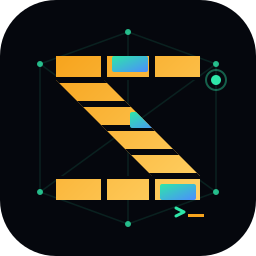

<div align="center">
  

  <h1>ZigFS</h1>

  <p>轻量级、单机、S3 兼容对象存储，使用 Zig 构建。</p>
</div>

ZigFS 面向需要自托管对象存储的开发团队和业务系统，提供标准 S3 文件操作、版本管理、生命周期规则、可恢复分片上传，以及独立的管理 API。当前版本为 `0.1.0` Release Candidate，仍属于开发版本。

> **核心原则**：先把 ZigFS 的 S3 API 做到标准、稳定、完整，再实现多语言 SDK。SDK 只封装 S3/Data API，不定义第二套文件协议。

## ✨ 特性概览

- **S3 兼容**：Bucket、Object、ListObjectsV2、Range、条件请求、Presigned URL、Multipart、CopyObject。
- **版本与恢复**：Bucket Versioning、DeleteMarker、指定版本读写、恢复删除对象、旧版本回溯。
- **生命周期管理**：当前版本、非当前版本和过期 DeleteMarker 的规则配置与后台扫描。
- **可恢复上传**：Multipart 支持按 Part 暂停、继续、失败重试、取消和刷新页面后恢复。
- **可靠存储**：自有 Metadata Engine、事务日志、崩溃恢复、损坏检测、索引重建和幂等 GC。
- **管理分层**：ZigFS 是唯一数据与权限来源，Admin 只是网页展示和 API 转发层。
- **轻依赖**：优先使用 Zig/Go 标准库，仅在必要场景引入第三方库。
- **无 SQLite**：对象数据和元数据由 ZigFS 自有存储机制维护，不依赖 SQLite 或外部数据库。

## 🧭 架构

```
File SDK / S3 Client
        │ S3/Data API
        ▼
      ZigFS ───────────────► Object Data + Metadata Engine
        ▲
        │ Management API
        │
   Go + Gin BFF
        ▲
        │ Admin BFF API
        │
   React Admin Web
```

仓库包含两个独立项目：

| 项目 | 职责 |
| --- | --- |
| `zigfs/` | Zig 数据面，负责 S3/Data API、Management API、认证、对象数据和元数据 |
| `zigfs-admin/` | 可选管理页面；React Web 展示与交互，Go + Gin Server 负责静态资源和接口转发 |

Admin 不直接访问数据目录，也不保存 Bucket、Object、版本、AK/SK 或管理员账号。即使移除 Admin，ZigFS 仍可独立提供 S3 API 和 Management API，供其他系统直接对接。

## 📚 目录

- [快速开始](#-快速开始)
- [配置](#️-配置)
- [API 边界](#-api-边界)
- [开发命令](#️-开发命令)
- [兼容性与验证](#-兼容性与验证)
- [项目结构](#-项目结构)
- [进一步阅读](#-进一步阅读)

## 🚀 快速开始

### 环境要求

- Zig `0.16.0` 或更新版本
- Go `1.27` 或更新版本
- Node.js `24` 或兼容版本
- pnpm
- Docker Desktop 或其他 Docker Engine（仅 Docker 部署需要）

### 本地启动

根目录脚本提供统一菜单：

```bash
./start.sh
```

顶层菜单包含：

1. 启动本地 ZigFS
2. 启动本地 Admin
3. Docker 服务
0. 退出

本地 Admin 只启动本地 Go Admin Server，不会自动启动 ZigFS；使用本地 Admin 前，请先在另一个终端启动 ZigFS。首次启动 Admin 前先安装前端依赖：

```bash
cd zigfs-admin/web
pnpm install
```

### Docker Compose 启动

进入 `Docker 服务` 后，可执行：

- 构建 ZigFS 镜像
- 构建 Admin 镜像
- 构建全部镜像
- 通过 Compose 启动 ZigFS
- 通过 Compose 启动 Admin（自动带起 ZigFS）
- 停止开发服务
- 返回上一级

Docker 菜单中的启动操作使用 `docker-compose.dev.yml`。启动 Admin 时，Compose 通过 `depends_on` 自动启动 ZigFS，并等待 ZigFS 健康检查通过。启动命令使用 `--no-build`，因此镜像构建和容器启动是两个明确步骤；镜像重新构建后再次启动服务，Compose 会使用新镜像重新创建容器。数据保存在 `zigfs-dev-data` Docker volume 中，容器重建不会删除数据。

也可以直接运行 Compose：

```bash
# 构建本地镜像并启动两个服务
docker compose -f docker-compose.dev.yml up -d --build

# 查看状态和日志
docker compose -f docker-compose.dev.yml ps
docker compose -f docker-compose.dev.yml logs -f zigfs admin

# 停止开发服务
docker compose -f docker-compose.dev.yml down
```

默认端口：

| 端口 | 服务 |
| --- | --- |
| `9000` | ZigFS S3、Management、Health API |
| `9001` | Admin Web Console |
| `9090` | Prometheus Metrics，默认仅监听本机 |

可通过 `ZIGFS_API_PORT`、`ZIGFS_ADMIN_PORT`、`ZIGFS_METRICS_PORT` 修改主机映射端口。

## ⚙️ 配置

ZigFS 使用 YAML 配置文件，代码内部同时提供默认值。加载优先级为：

```
内置默认值 → YAML 配置 → 命令行覆盖
```

创建本地配置：

```bash
cd zigfs
cp config.example.yaml config.yaml
```

常用配置示例：

```yaml
server:
  api_address: "0.0.0.0:9000"

observability:
  metrics_enabled: true
  metrics_address: "127.0.0.1:9090"

storage:
  data_root: "data"
  stream_buffer_size: 65536

s3:
  public_endpoint: "http://127.0.0.1:9000"
  virtual_hosted_style: false
  region: "us-east-1"
  request_time_skew_seconds: 900
  multipart_expiry_seconds: 604800
  lifecycle_scan_interval_seconds: 300

admin:
  username: "admin"
  password: "zigfs-admin"
  session_secret: "change-before-production"
  session_ttl_seconds: 28800
```

`server.api_address` 是实际监听地址；`s3.public_endpoint` 用于生成客户端可访问的 Presigned URL。开启 `s3.virtual_hosted_style` 后，还需要让 DNS 或反向代理解析 `<bucket>.<authority>` 形式的地址。

管理员账号、密码和 Session Secret 都由 ZigFS 保存和校验，Admin 不维护副本。对外部署前必须修改默认凭证和 `session_secret`。

## 🔌 API 边界

三类接口职责明确，契约文档集中维护在 [`docs/api/`](docs/api/)：

| 接口 | 面向对象 | 主要能力 |
| --- | --- | --- |
| **S3/Data API** | 文件 SDK、AWS CLI、mc、rclone、业务服务 | Bucket/Object、Multipart、Range、Presigned、Versioning、Lifecycle |
| **ZigFS Management API** | Admin BFF、授权管理系统 | Bucket 配置、对象历史、AK/SK、Storage、System、Health、Settings |
| **Admin BFF API** | React Admin Web | 登录、页面数据加载和管理操作转发，不承载文件协议 |

- S3 API 契约：[S3 API 覆盖范围](docs/api/s3-api-coverage.md)
- ZigFS Management API：[OpenAPI](docs/api/zigfs-management-v1.openapi.yaml)
- Admin BFF API：[OpenAPI](docs/api/admin-bff-v1.openapi.yaml)
- API 文档索引：[docs/api/README.md](docs/api/README.md)

多语言 SDK 主要服务 Android、iOS、Web 和业务服务中的文件上传下载。AK/SK 创建、禁用和删除属于管理操作，不进入文件 SDK。

## 🛠️ 开发命令

### ZigFS

```bash
cd zigfs
zig build test
zig build run
```

指定配置文件：

```bash
zig build run -- --config ./config.yaml
```

### Admin Server

```bash
cd zigfs-admin/server
go test ./...
ZIGFS_ENDPOINT=http://127.0.0.1:9000 go run ./cmd/admin
```

主要环境变量：

| 变量 | 默认值 | 用途 |
| --- | --- | --- |
| `ZIGFS_ADMIN_LISTEN` | `:9001` | Admin HTTP 监听地址 |
| `ZIGFS_ENDPOINT` | `http://127.0.0.1:9000` | ZigFS API 地址 |
| `ZIGFS_WEB_ROOT` | `../web/dist` | React 构建产物目录 |
| `ZIGFS_UPSTREAM_TIMEOUT` | `15m` | 管理请求最长等待时间 |

### Admin Web

```bash
cd zigfs-admin/web
pnpm install
pnpm run typecheck
pnpm run build
pnpm run dev
```

开发服务器默认地址为 `http://127.0.0.1:5173`，会将 `/api` 和 `/health` 代理到 `http://127.0.0.1:9001`。

## ✅ 兼容性与验证

项目使用真实 TCP 集成测试、外部客户端矩阵和语言无关 SDK Conformance 验证 S3 契约：

```bash
# AWS CLI、mc、rclone 和原生 HTTP 兼容性矩阵
./compatibility/run.sh

# TypeScript/Web 与 Swift/iOS SDK 一致性验证
./conformance/run.sh

# Small/Large Object、并发、Multipart、Range 和 CRUD 基准
node benchmarks/run.mjs
```

兼容性报告不包含凭证。完整范围、环境要求和未实现边界见：

- [兼容性测试说明](compatibility/README.md)
- [SDK Conformance 契约](docs/sdk/conformance.md)
- [基准测试说明](docs/benchmarks.md)
- [已知限制](docs/known-limitations.md)

## 📁 项目结构

```
.
├── zigfs/                 # ZigFS 数据面
│   ├── build.zig
│   ├── config.example.yaml
│   └── src/
│       ├── application/   # 应用服务
│       ├── auth/           # SigV4、策略和管理会话
│       ├── backend/        # 本地数据存储
│       ├── domain/         # Bucket、Object、Multipart、Credential
│       ├── metadata/       # Metadata Engine、Journal、Recovery
│       ├── ports/          # 存储与事务接口
│       └── transport/      # S3、Management、Health、Metrics
├── zigfs-admin/
│   ├── server/             # Go + Gin BFF
│   └── web/                # React Admin Web
├── docs/                   # API、运维、SDK、发布文档
├── compatibility/          # AWS CLI、mc、rclone 兼容性 Runner
├── conformance/            # TypeScript/Web、Swift/iOS 一致性验证
├── benchmarks/             # 可复现基准工具
├── docker-compose.dev.yml  # 开发 Compose
├── start.sh                # 本地与 Docker 交互式菜单
└── LICENSE                 # Apache License 2.0
```

## 📚 进一步阅读

- [运维手册](docs/operations.md)
- [存储扫描与文件清理架构](docs/storage-reclamation.md)
- [备份与恢复](docs/backup-and-recovery.md)
- [配置参考](docs/configuration.md)
- [SDK 设计](docs/sdk/design.md)
- [发布候选说明](docs/release/v1-release-candidate.md)
- [变更记录](CHANGELOG.md)

## 📄 开源协议

本项目基于 [Apache License 2.0](LICENSE) 开源。
