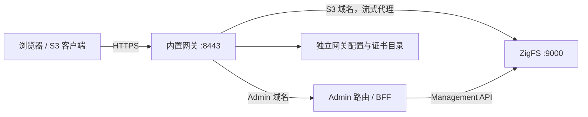

# 内置 HTTPS 网关设计与实施计划

状态：第一版源码已实现，网关已提取到独立 Go module `pkg/gateway`，Admin 通过适配层集成。部署需新构建镜像，外部部署验收仍需在目标环境执行。本文保留设计基线；实际接口和使用流程以 [操作文档](../gateway.md) 与 [OpenAPI](../api/gateway.openapi.yaml) 为准。

第一版落地差异：证书生成 / 导入合并在准备配置接口；网关前置多层代理的信任链解析暂不提供；CA 不自动轮换；变更通过 ZigFS 审计接收有限枚举的 requested / succeeded / failed 报告，结果报告失败记录本地诊断。客户端验证由浏览器探测两个公开 HTTPS 入口完成。

## 1. 目标与背景

ZigFS 当前通过 HTTP 提供 S3 和 Management API，Admin 通过 Go BFF 提供网页和管理接口。用户在 NAS、1Panel 或普通 Docker 上启用 HTTPS 时，需要自行配置代理、证书和域名。部分 NAS 应用入口会将未登录的 OPTIONS 请求重定向到 NAS 登录页，导致浏览器无法访问预签名 S3 URL。

新增内置网关，提供 TLS 终止、按域名路由、证书管理和部署诊断。管理员在 Admin 的“系统设置 → 网络”中完成配置，无需另行部署和维护 Nginx 或 Caddy。

第一版实现范围：

- 一个可选的 HTTPS 监听器，服务 Admin 和 S3 两个明确配置的域名。
- 自动生成本地 CA 和站点证书，自动续签站点证书；支持导入证书链和私钥。
- 下载 CA 公共证书，提供客户端信任和 DNS 设置指引。
- 候选配置校验、启用检测、可恢复的应用流程和状态诊断。
- Docker / NAS / 1Panel 部署说明，支持非默认 HTTPS 端口。

已追加 macOS 本机扩展：回环 UDP/TCP DNS、专用 resolver 配置与 CA 信任安装/卸载助手（需用户执行并授权）。

不纳入第一版：局域网 DNS 托管、修改路由器设置、mDNS 广播、无授权安装客户端 CA、公网隧道、ACME / DNS 服务商集成、按访问者自动切换 S3 Endpoint、虚拟主机式 Bucket 寻址。

## 2. 使用边界

### 2.1 本地域名

默认示例使用 `admin.zigfs.home.arpa` 与 `s3.zigfs.home.arpa`。管理员必须通过内网 DNS 或客户端 hosts 将两者解析到部署主机。网关不拥有操作系统或路由器的 DNS 配置权限。

`.local` 通常用于 mDNS，Docker 桥接网络与客户端支持不一致，因此不作为默认方案。`.orb.local` 由 OrbStack 的本地集成提供，不由 ZigFS 接管。

域名访问可以局限于内网；网关不会自动提供公网可达性。管理员也可使用自有域名和已签发证书。

### 2.2 HTTPS 信任

自动签发的本地证书只有在客户端信任本地 CA 后，才不会出现证书错误。网页不能代替用户安装根证书。页面提供 CA 下载、SHA-256 指纹及操作系统安装说明，不引导用户关闭 TLS 校验。

通过已有可信渠道核对 CA 指纹，避免首次从未认证 HTTP 入口取得根证书时错误信任其他服务。服务端检测通过不代表用户设备已信任证书或正确解析域名。

### 2.3 端口与容器

网关默认关闭，启用时容器内默认监听 `:8443`，以普通用户运行。宿主机可映射 `8443:8443`，也可在 443 空闲时使用 `443:8443`。

页面不能修改 Docker 端口发布、NAS 防火墙或路由器配置。内部监听端口与外部访问端口独立配置。使用外部 8443 时，Public URL 必须包含 `:8443`。

## 3. 架构决策

第一版采用 `pkg/gateway` 独立 Go module，由 Admin Go 进程嵌入并提供 HTTPS 监听器，复用现有部署单元，不新增必需容器。模块与 BFF 路由保持隔离，后续可以提取成独立进程。



- Admin 域名将请求交给现有 Admin HTTP Handler，保留认证、CSRF、安全头和静态文件行为。
- S3 域名通过 Go `net/http/httputil.ReverseProxy` 转发到部署配置中的 ZigFS 上游，不经过 Admin 会话鉴权或 JSON 包装。
- S3 请求仍由 ZigFS 完成签名校验和授权。网关不签发凭据、不读取或写入 ZigFS 数据目录。
- 网关的配置、证书和密钥属于部署层状态，保存在 Admin 独立持久卷；ZigFS 的 Public URL 仍由 Management API 管理。
- 对象字节会经过网关，但不经过 BFF 业务处理。实现时必须更新当前文档中“对象字节不经过 Admin”的表述，明确网关与 BFF 的职责差异。
- 原有 HTTP 9001 保留为配置与恢复入口；是否在主机发布该端口由部署者决定。S3 HTTP 9000 可只在 Compose 内部网络暴露。

## 4. 路由与签名规则

### 4.1 域名分发

两个域名必须不同，第一版只接受明确的 DNS 主机名，不支持任意通配域名、路径前缀或 URL 中的用户名密码。按解析后的 Host 匹配；规范化域名大小写并正确处理端口。未知 Host 拒绝，不回落到默认站点，不根据任意请求头生成证书。

TLS SNI 与 HTTP Host 的匹配规则必须明确：已配置域名间不允许借用另一个域名的 TLS 会话进行跨站路由，未知 SNI 握手失败。证书 SAN 必须覆盖启用的两个域名。

### 4.2 S3 数据路径

- 原样保留客户端 Host（含非默认端口）、HTTP 方法、转义路径和原始查询参数。
- 不清理重复斜杠，不将 `%2F` 解码后重新拼路径，不修改预签名参数顺序或编码。
- 直通 PUT、GET、HEAD、DELETE、POST、OPTIONS；预检不登录、不重定向。
- 原样透传 ZigFS 的 CORS 响应，不追加重复或相互冲突的允许来源头，不限定某一个 Admin 域名。
- 支持 Range、条件请求、ETag、分片上传、复制请求头、错误 XML 和响应 trailer。
- 请求和响应流式转发，不整文件读入内存或磁盘；客户端取消时终止上游请求。
- 使用独立于 BFF JSON 接口的传输配置；不将 BFF 的短请求读取超时直接应用到大文件上传。设置建连、响应头、空闲连接超时，长传输策略须通过慢速上传测试确定。
- 网关自生成的上游失败响应需要可诊断，并对合法 S3 跨域请求提供一致的 CORS 行为；不得伪造上传成功或覆盖上游业务错误。
- 日志不记录完整预签名查询字符串、Authorization、Cookie 或证书私钥。

### 4.3 代理信任

网关丢弃不可信客户端传入的转发头，并设置它观察到的客户端 IP 和协议。外面还有受信代理时，仅按显式可信代理列表解析转发链。

ZigFS 如需按 HTTPS / 客户端 IP 执行 IAM 条件，必须信任实际连接它的网关来源。不能自动信任 `0.0.0.0/0` 或任意容器网段。设置页面解释实际来源与配置方式；跨进程调用由 ZigFS Management API 保存。

第一版不将外部 S3 域名变成 Management API 的额外入口：在网关 S3 路由显式拒绝 `/_admin` 管理命名空间，其它 S3 路径保持原样。BFF 继续通过内部上游调用 Management API。

## 5. 证书与私钥生命周期

### 5.1 本地 CA

- 首次启用时在服务端生成实例专属 CA 私钥，禁止在镜像中预置共享 CA。
- 使用 Go `crypto/x509` 生成 CA 和含两个域名 SAN 的服务器证书；服务器证书包含正确的 ServerAuth 用途。
- 建议 CA 有效期 5 年、站点证书 90 天、到期前 30 天自动续签；实际常量纳入测试并可在未来版本调整。
- 续签复用原 CA，自动原子替换证书，已有连接不受影响。
- CA 私钥仅服务端保存；下载接口只返回公开 CA 证书。导入证书的私钥也不提供读取接口。
- 明确展示 CA 指纹、有效期、服务器证书域名与续签状态。
- CA 轮换是显式维护操作，需要重新部署客户端信任；第一版不自动轮换 CA。

### 5.2 导入证书

支持 PEM 证书链和未加密私钥上传，检查密钥匹配、SAN、有效期和用途，限制上传大小。导入失败不影响当前证书。第一版不自动续签外部证书，页面提前提示到期。

私钥文件权限设为 `0600`，配置目录限制为运行用户可访问；写入使用临时文件、落盘和原子替换。备份必须包含网关状态与密钥，不得提交到 Git。丢失本地 CA 后不能无感重建信任。

## 6. Admin 设置体验

在现有“网络”页面增加“HTTPS 网关”，复用 shadcn/ui 组件并覆盖中英文、键盘操作和明暗主题。

| 区域 | 字段 / 信息 |
|---|---|
| 开关与状态 | 未启用、准备中、运行中、应用失败、证书即将到期 |
| 访问地址 | Admin 域名、S3 域名、外部 HTTPS 端口 |
| 监听 | 容器内监听地址与端口；说明主机端口映射要求 |
| 证书 | 本地 CA / 导入证书，SAN、有效期、指纹 |
| 本地 CA | 下载公共证书、各平台安装指引 |
| 检测 | 服务端监听、证书、上游可达、客户端 HTTPS 连通性与 S3 预检 |
| 恢复 | 当前生效配置、候选配置、上次失败原因 |

交互顺序：填写域名与端口 → 配置 DNS / 映射 → 生成或导入证书 → 信任 CA → 验证候选 HTTPS 地址 → 应用 S3 Public URL。

生成证书和检测等操作显示局部状态，不用全屏阻塞弹窗。错误用现有 ToastProvider；证书状态和部署指导是持久信息。CA 更换等影响信任的操作使用 ConfirmProvider。

浏览器无法读取跨域 TLS 失败的详细原因：检测失败时不能武断显示“证书不可信”，应提示检查 DNS、证书、端口和代理，并区分服务端探测与客户端探测。

浏览器探测接口只返回最少的可达性信息；允许配置的 Admin 来源进行无凭据探测，不因此对所有 BFF 管理接口开放 CORS。

## 7. 配置应用与故障恢复

不能把“网关配置保存”和“ZigFS Public URL 更新”假设成一个事务。

1. 保存候选配置并校验证书、域名和端口；不修改当前 Public URL。
2. 预启动候选监听器；同端口修改采用经校验的不可变配置快照切换。失败保留旧状态。
3. 用户从实际客户端完成域名解析、信任和连通性检查。仅服务器自身检查成功不自动切换入口。
4. 通过已授权的 Management API 将 Public URL 更新为候选 S3 HTTPS 地址，再将该应用版本标为完成。
5. 若更新 Public URL 失败，保留原 Public URL 和原可用入口，记录部分应用状态，支持重试或撤销。
6. 如果 Public URL 已更新而最终落盘失败，恢复流程应对照实际 ZigFS 状态协调，而不是盲目覆盖。使用配置修订号和应用记录处理重启中断、并发编辑。
7. 停用网关前明确选择后续 S3 Public URL，避免生成指向已停止入口的链接。提示已有预签名链接不会被重写。

网关失效不得导致原 Admin HTTP 恢复入口一起退出。证书过期不得静默降级为 HTTP。配置目录损坏、监听端口占用时提供明确日志和页面状态。

## 8. 拟议接口和持久化

通过 BFF 提供部署层接口，所有管理操作复用现有会话认证、`admin:*` 权限验证和 CSRF 防护。不可仅靠前端隐藏入口。ZigFS 仍决定会话身份及权限。

| 拟议接口 | 用途 |
|---|---|
| `GET /api/v1/settings/gateway` | 生效 / 候选配置与状态，不返回私钥 |
| `PUT /api/v1/settings/gateway` | 校验并保存候选配置，带期望修订号 |
| `POST /api/v1/settings/gateway/certificates/local` | 生成本地 CA / 站点证书 |
| `POST /api/v1/settings/gateway/certificates/import` | 导入证书与私钥 |
| `GET /api/v1/settings/gateway/ca.crt` | 下载公共 CA 证书 |
| `POST /api/v1/settings/gateway/check` | 对已配置目标执行受限检测 |
| `POST /api/v1/settings/gateway/apply` | 应用候选配置与 Public URL |
| `POST /api/v1/settings/gateway/rollback` | 撤销未完成的配置应用 |

接口不能接受任意探测 URL 或任意代理目标，避免变成开放代理。上游使用受管理的 ZigFS Endpoint；目标解析和连接行为纳入验证。

拟议持久目录：`/app/config/gateway/`，包含版本化配置、应用状态、本地 CA 和证书文件。新增环境变量 `ZIGFS_GATEWAY_CONFIG_DIR` 指向该目录，默认关闭网关。配置读取、文件权限与迁移独立于 ZigFS 存储格式。

上述命名在实现时与现有 API 契约统一，并更新 Admin OpenAPI、网络设置 API、配置参考及审计目录。审计记录启用、停用、域名变更、证书导入、CA 创建、应用和回滚，不记录私钥；审计写入方式需复用 ZigFS 的管理审计机制，不能以本地日志替代权限审计。

## 9. Docker 部署形态

以下为未来支持网关的镜像部署片段，不适用于现有 alpha.7：

```yaml
services:
  zigfs:
    # 其余镜像、数据卷与环境变量沿用项目 Compose。
    expose:
      - "9000"
  admin:
    ports:
      - "9001:9001" # 首次设置与恢复入口
      - "8443:8443" # 可在宿主机 443 空闲时改为 443:8443
    volumes:
      - zigfs-admin-config:/app/config
    environment:
      ZIGFS_ENDPOINT: "http://zigfs:9000"
      ZIGFS_GATEWAY_CONFIG_DIR: "/app/config/gateway"
volumes:
  zigfs-admin-config:
```

这是独立部署形态示意，不是会自动删除原 `ports` 的 Compose 覆盖文件。若希望取消宿主机的 9000 发布，需要明确修改最终 Compose。

示例外部端口 8443 对应 `https://admin.zigfs.home.arpa:8443` 和 `https://s3.zigfs.home.arpa:8443`。本地 DNS 指向 NAS / 1Panel 主机 IP，不指向容器 IP。

Admin 镜像必须保证新配置卷对运行用户可写；bind mount 的初始化方案与命名卷都需要测试。已在宿主机监听 443 的 NAS / 1Panel 不受自动修改。

## 10. 实施阶段

| 阶段 | 产出 | 完成标准 |
|---|---|---|
| A：配置与证书 | Go 网关模块、版本化状态、CA / 导入证书支持 | 密钥权限、原子写入、证书验证及重启恢复测试通过 |
| B：监听与代理 | HTTPS 监听、域名路由、S3 流式代理 | SigV4、OPTIONS、Range、大文件与取消测试通过 |
| C：管理接口 | 权限校验、状态、检测、应用与回滚 | 未授权拒绝、并发修改与部分失败恢复测试通过 |
| D：Admin 页面 | 网关设置、证书下载、引导和诊断 | 本地 CA 与导入证书流程均可完成，错误可见 |
| E：部署交付 | Docker 持久化、示例、API / 操作文档 | NAS / 普通 Docker 完整验收，现有 HTTP 部署回归通过 |

实现落点建议：独立 Go module `pkg/gateway/` 负责 TLS、证书、路由与运行状态；`cmd/admin` 负责生命周期；现有 handler/service 层提供受保护的管理接口；Web 在现有网络设置功能内扩展。

## 11. 验收清单

- 新部署不启用网关时，现有 HTTP、CLI、S3 SDK 和 Admin 行为保持兼容。
- 两个域名可通过单个 HTTPS 端口访问；未知 Host / SNI 被拒绝。
- 本地 CA 模式在信任前明确报证书错误，信任后通过正常 TLS 校验，不使用跳过校验参数。
- 导入证书错误、域名不匹配、过期、私钥不匹配、端口占用不会破坏旧入口。
- 中文、空格、`+`、`%`、编码斜杠和嵌套目录对象的签名上传下载删除正常。
- 来自不同 Admin Origin 的默认 CORS 预检正常，不硬编码单个域名；桶自定义 CORS 保持原语义。
- 分片上传、零字节对象、Range、HEAD、复制、版本删除和 S3 错误响应正常。
- 慢速上传、大文件下载和客户端取消不导致整文件缓冲、无限内存增长或连接泄漏。
- 伪造转发头不能改变鉴权上下文；公网 S3 入口不能直接访问管理命名空间。
- 续签不打断传输；重建容器保留 CA；备份恢复保持证书信任。
- 应用失败、Public URL 更新失败、落盘失败和进程重启均可恢复，旧入口可用于修复。
- 网关管理操作有服务端权限校验和审计，日志不泄漏凭据、签名或私钥。
- Go 执行 `go test ./...`；Web 执行构建与 i18n 检查；涉及 Zig 管理契约变更时执行 `zig build test`。
- 发布前完成真实浏览器交互验证和至少一个 NAS / Linux Docker 环境验收，记录版本与测试结果。

## 12. 后续扩展

后续可评估 ACME DNS-01、用户自有域名、mDNS（仅支持的部署模式）、网关独立进程、虚拟主机式 S3、多个经批准的 Public URL。它们不作为第一版上线前置条件，也不在界面中预先宣称支持。


## 13. 抽包与验证入口

- `pkg/gateway` 独立拥有 TLS、流式代理、证书、版本化持久状态与 macOS DNS，
  不依赖 Admin internal 包或 Gin；`go.work` 将本地源码直接接入 Admin。
- Admin handler 负责会话、权限、CSRF、审计和 ZigFS 网络状态 CAS 适配。
- 独立包测试：`cd pkg/gateway && GOWORK=off go test -race ./...`。
- Admin 集成测试：`cd zigfs-admin/server && go test ./...`。
- Docker Admin 构建上下文改为仓库根目录，使用独立 Dockerfile ignore 白名单。
- CI 同时覆盖 macOS 与 Linux 的独立网关测试和 Admin 集成。

交付状态以实际验证记录为准。源码及本地自动化完成不等于镜像已发布，
也不等于已经在所有目标设备完成 DNS、证书信任和网络吞吐验收。

### 本轮完成与剩余验证

| 项目 | 状态 |
|---|---|
| 独立 pkg、Admin 适配、workspace 与独立构建 | 已完成，Go 测试通过 |
| TLS、状态恢复、签名透明转发、DNS | 独立 macOS/Linux 测试通过 |
| 分块上传、下载即时刷新、trailer、故障响应 | 已补测试并通过 |
| 页面保存步骤、草稿保护、证书临期状态 | 已完成，浏览器验证通过 |
| 构建脚本、CI、API 与操作文档 | 已更新；CI 待远程执行 |
| Linux AMD64 / ARM64 Admin | 交叉编译通过 |
| 完整多阶段镜像与发布 | 基础镜像下载慢，本轮构建停止，尚未完成或发布 |
| 本机真实 DNS/CA 信任 | Chrome 正常 TLS 校验，Admin/S3 探测均为 200 |
| Linux 网关容器运行验收 | 严格 TLS/S3 全流程、重建保持 CA、配置卷权限已通过 |
| 长期运行吞吐及跨设备迁移 | 保留部署验收，不由短时测试代替 |


### 协议与恢复清单补齐

已添加 `conformance/gateway_https.py`（原生 / Linux Admin 容器两种模式），
完成默认与桶 CORS、特殊路径、零字节、Range、HEAD、条件请求、复制、分片、
版本删除、证书导入/拒绝/回滚、重建保持 CA、停用恢复的真实服务检查。
Go 测试覆盖最终落盘失败后的重启协调、候选保存失败保持旧入口和续签不中断传输。
证书页面现在展示实际 SAN、站点 SHA-256 指纹与本地/导入证书的续签策略。
具体命令与验证边界见 [验证记录](../../zigfs-admin/docs/gateway-validation.md)。


### Windows 本机助手

已增加 `local-setup.ps1`，在 Windows Admin 页面自动显示下载入口与安装/卸载命令。
通过 UAC 授权，在 hosts 中维护带 CA 指纹的 ZigFS 区块并配置系统 CA 信任；
不依赖 macOS DNS 服务，不覆盖无关记录或冲突配置。Windows 状态检查兼容 UTF-8
和 UTF-16 hosts 文件。网关状态落盘使用 Windows write-through 文件替换，避免
POSIX 目录同步在 Windows 上失败。

本机已通过公共 CA 导出、非法域名拒绝、hosts 状态检测、Admin 回归、Windows
交叉编译及浏览器平台分支/下载测试。Windows PowerShell 语法与安装/卸载逻辑测试
已加入 Windows CI（临时 hosts + 当前测试用户证书库，不修改系统 hosts）。
当前 macOS 环境未执行 Windows 原生测试及真实 UAC，需 Windows CI/设备验收。
