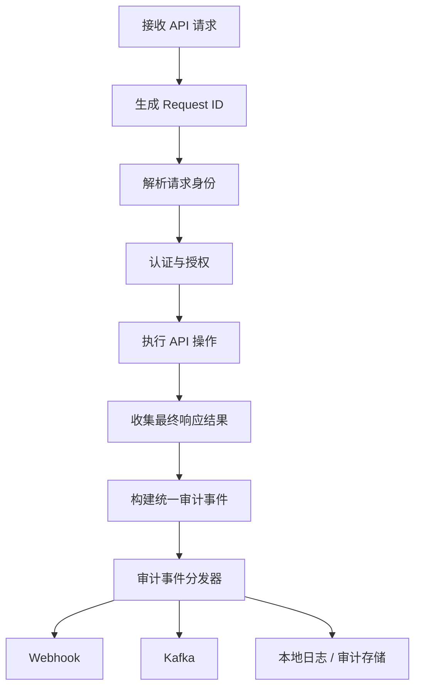

# RustFS 审计日志结构规范（Audit Event Schema）

**版本：** V1.0\
**日期：** 2026-11-11\
**状态：** 建议规范

## 1. 设计目标

为 RustFS 管理中心及对象存储审计功能定义统一的、结构化的审计事件模型。

设计目标：

-   以 API 请求级记录为核心，追踪主体对资源执行的操作及结果。
-   统一身份、请求、资源、操作、响应等字段。
-   使用 JSON 结构化输出，便于查询、过滤、分析和转发。
-   支持单机部署，并为未来多节点、Webhook、Kafka、集中式审计存储预留扩展能力。
-   避免记录凭证、敏感请求体等机密信息。

## 2. 标准事件结构

以下是规范模型示例。它是建议的统一结构，不保证与 RustFS
当前版本的原生审计事件字段完全一致。

``` json
{
  "schema_version": "1.0",
  "event_id": "evt_019AABBCCDDEEFF0011223344",
  "event_time": "2026-11-11T10:30:00.123Z",
  "event_category": "object_storage",
  "event_type": "api_request",
  "event_action": "DeleteObject",
  "request": {
    "request_id": "req_019AABBCCDDEEFF0011223344",
    "method": "DELETE",
    "protocol": "HTTP/1.1",
    "path": "/images/avatar.png",
    "query": {},
    "user_agent": "aws-cli/2.31.0",
    "source_ip": "192.168.1.100"
  },
  "identity": {
    "auth_type": "s3_access_key",
    "principal_id": "user_001",
    "principal_name": "user001",
    "access_key_id": "AKIAEXAMPLE",
    "session_id": null
  },
  "resource": {
    "type": "object",
    "bucket": "images",
    "object_key": "avatar.png",
    "version_id": null
  },
  "operation": {
    "name": "DeleteObject",
    "service": "s3",
    "is_read_only": false
  },
  "response": {
    "status": "success",
    "http_status": 204,
    "error_code": null,
    "error_message": null,
    "duration_ms": 12
  },
  "metadata": {
    "region": "us-east-1",
    "server_id": "rustfs-node-01"
  }
}
```

## 3. 顶层字段定义

  字段               类型         必填 说明
  ------------------ ---------- ------ -----------------------------
  `schema_version`   string         是 审计事件结构版本
  `event_id`         string         是 全局唯一事件 ID
  `event_time`       datetime       是 UTC 事件时间，RFC 3339 格式
  `event_category`   string         是 事件所属分类
  `event_type`       string         是 事件类型
  `event_action`     string         是 具体动作名称
  `request`          object         是 请求上下文
  `identity`         object         是 操作主体身份
  `resource`         object         是 被操作资源
  `operation`        object         是 操作语义
  `response`         object         是 操作结果
  `metadata`         object         否 系统扩展元数据

## 4. 事件分类与类型

### 4.1 `event_category`

  值                    说明                   示例
  --------------------- ---------------------- -------------------
  `object_storage`      对象存储 API 操作      `PutObject`
  `identity`            用户、身份及认证相关   `CreateUser`
  `access_control`      权限、策略相关         `PutBucketPolicy`
  `bucket_management`   Bucket 管理            `CreateBucket`
  `system_management`   系统管理操作           修改系统配置
  `kms`                 密钥管理               `CreateKey`
  `security`            安全相关事件           认证失败

### 4.2 `event_type`

  值                 说明
  ------------------ ------------------------
  `api_request`      S3 或其他 API 请求事件
  `admin_action`     管理中心操作事件
  `security_event`   安全事件
  `system_event`     系统事件

管理中心通过 S3 API 修改 Bucket 时，事件可以归类为
`api_request`；通过内部管理接口修改系统配置时，可以归类为
`admin_action`。

## 5. Request 请求上下文

``` json
{
  "request_id": "req_123456",
  "method": "PUT",
  "protocol": "HTTP/1.1",
  "path": "/images/avatar.png",
  "query": {
    "versionId": "example-version"
  },
  "user_agent": "aws-sdk-go-v2",
  "source_ip": "192.168.1.100"
}
```

  字段           类型       必填 说明
  -------------- -------- ------ -----------------------------------
  `request_id`   string       是 请求关联 ID，应可关联服务运行日志
  `method`       string       是 HTTP 方法
  `protocol`     string       否 HTTP 协议版本
  `path`         string       是 请求路径，需注意脱敏
  `query`        object       否 经过敏感参数过滤的查询参数
  `user_agent`   string       否 客户端 User-Agent
  `source_ip`    string       否 请求来源 IP，代理场景需正确解析

## 6. Identity 身份信息

``` json
{
  "auth_type": "s3_access_key",
  "principal_id": "user_001",
  "principal_name": "user001",
  "access_key_id": "AKIAEXAMPLE",
  "session_id": null
}
```

  字段               类型            必填 说明
  ------------------ ------------- ------ ----------------------------
  `auth_type`        string            是 认证方式
  `principal_id`     string            否 主体唯一 ID
  `principal_name`   string            否 主体名称
  `access_key_id`    string            否 Access Key ID，不是 Secret
  `session_id`       string/null       否 会话或临时凭证关联 ID

建议 `auth_type` 枚举：

-   `s3_access_key`
-   `sts`
-   `oidc`
-   `anonymous`
-   `internal`

## 7. Resource 资源信息

``` json
{
  "type": "object",
  "bucket": "images",
  "object_key": "avatar.png",
  "version_id": null
}
```

  字段           类型            必填 说明
  -------------- ------------- ------ -------------
  `type`         string            是 资源类型
  `bucket`       string/null       否 Bucket 名称
  `object_key`   string/null       否 对象键
  `version_id`   string/null       否 对象版本 ID

建议 `type` 枚举：

-   `bucket`
-   `object`
-   `user`
-   `group`
-   `policy`
-   `access_key`
-   `kms_key`
-   `system`

对于 `ListBuckets` 等没有具体对象的请求，相关资源字段允许为 `null`
或省略。

## 8. Operation 操作语义

``` json
{
  "name": "DeleteObject",
  "service": "s3",
  "is_read_only": false
}
```

  字段             类型        必填 说明
  ---------------- --------- ------ -----------------------------------
  `name`           string        是 标准化操作名称
  `service`        string        是 服务标识，如 `s3`、`admin`、`kms`
  `is_read_only`   boolean       是 是否为只读操作

操作名称应优先使用稳定、明确的 API 名称，例如
`PutObject`、`GetObject`、`DeleteBucket`。

## 9. Response 操作结果

``` json
{
  "status": "success",
  "http_status": 204,
  "error_code": null,
  "error_message": null,
  "duration_ms": 12
}
```

  字段              类型            必填 说明
  ----------------- ------------- ------ ----------------------
  `status`          string            是 规范化操作结果
  `http_status`     integer           是 HTTP 状态码
  `error_code`      string/null       否 标准化错误码
  `error_message`   string/null       否 安全处理后的错误描述
  `duration_ms`     integer           是 请求耗时，单位毫秒

建议 `status` 枚举：

-   `success`：操作成功
-   `failure`：操作执行失败
-   `denied`：认证或授权拒绝
-   `error`：服务端错误
-   `unknown`：无法判定结果

## 10. Metadata 扩展元数据

``` json
{
  "region": "us-east-1",
  "server_id": "rustfs-node-01"
}
```

`metadata` 用于放置非核心、可扩展字段，例如：

-   `region`
-   `server_id`
-   `deployment_id`
-   `tenant_id`（多租户场景）
-   `trace_id`

不要将核心查询字段仅放在 `metadata` 中，以免影响检索与索引。

## 11. 事件生成与处理流程



处理原则：

1.  审计事件应覆盖成功请求、认证失败、授权拒绝及服务端错误。
2.  尽可能在请求处理链路统一生成事件，避免各 Handler 手工拼接不同格式。
3.  事件分发可采用异步方式，减少对请求性能的影响。
4.  若要求严格审计可靠性，应使用持久化队列、重试、故障告警等机制；仅使用内存队列不能保证进程崩溃时事件不丢失。
5.  事件应能通过 `request_id` 关联普通运行日志。

## 12. 安全与隐私规范

禁止记录：

-   Secret Access Key
-   Authorization Header
-   Session Token
-   完整签名信息
-   密码、私钥及 KMS 密钥材料
-   未经必要性评估的完整请求或响应 Body

其他建议：

-   对 Query 参数进行 allowlist 或敏感键过滤。
-   对 `error_message` 进行脱敏，避免泄露内部路径、凭证或堆栈。
-   对对象键、用户名、IP
    等可能包含敏感信息的数据，依据部署场景设置访问控制与保留策略。
-   审计日志存储应限制读取权限，并考虑防篡改与备份。

## 13. API 操作映射建议

  ---------------------------------------------------------------------------------------------
  API 操作            `event_category`      `event_type`     `event_action`      资源类型
  ------------------- --------------------- ---------------- ------------------- --------------
  `PutObject`         `object_storage`      `api_request`    `PutObject`         `object`

  `GetObject`         `object_storage`      `api_request`    `GetObject`         `object`

  `DeleteObject`      `object_storage`      `api_request`    `DeleteObject`      `object`

  `ListObjects`       `object_storage`      `api_request`    `ListObjects`       `bucket`

  `CreateBucket`      `bucket_management`   `api_request`    `CreateBucket`      `bucket`

  `DeleteBucket`      `bucket_management`   `api_request`    `DeleteBucket`      `bucket`

  `PutBucketPolicy`   `access_control`      `api_request`    `PutBucketPolicy`   `policy`

  `CreateUser`        `identity`            `admin_action`   `CreateUser`        `user`

  `CreateKey`         `kms`                 `admin_action`   `CreateKey`         `kms_key`

  修改系统配置        `system_management`   `admin_action`   `UpdateConfig`      `system`
  ---------------------------------------------------------------------------------------------

此表是初始映射建议。实施时应以实际 API 路由、操作语义和 RustFS
版本为准。

## 14. V1.0 设计决策总结

-   统一 JSON 结构，使用 `schema_version` 管理演进。
-   以请求级审计为核心，覆盖 API 操作和管理操作。
-   将 `request`、`identity`、`resource`、`operation`、`response` 分层。
-   事件时间统一使用 UTC RFC 3339 格式。
-   使用稳定的事件 ID 与 Request ID 进行关联。
-   敏感凭证和请求 Body 默认不记录。
-   核心字段固定，扩展字段放入 `metadata`。
-   兼顾单机部署与未来多节点、集中式审计系统。

该规范可作为 RustFS 审计日志 V1.0 的设计基础，也可在未来用于其他 S3
兼容对象存储的统一审计查询系统。
