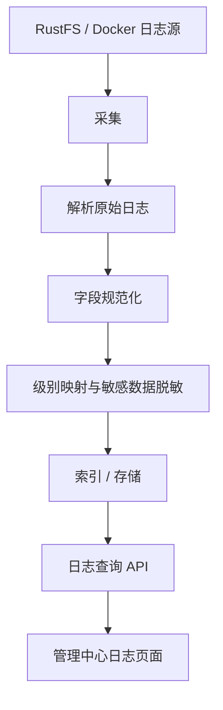

# RustFS 系统日志设计规范（System Logs）

**版本：** V1.0\
**日期：** 2026-11-11\
**状态：** 建议规范

## 1. 设计目标

为 RustFS
管理中心设计面向服务运维和故障排查的系统日志模块。系统日志与审计日志独立采集、存储、查询和配置。

系统日志用于排查服务启动失败、API
异常、请求超时、KMS/存储/网络组件故障、磁盘 I/O
与容量问题，以及异常发生和恢复的时间。

设计原则： - 采用结构化 JSON 日志。 -
以服务运行日志为主，不将用户操作审计混入系统日志。 -
统一日志级别、时间格式、服务身份和错误字段。 - 支持单机 Docker/NAS
部署，预留多节点及 OTLP 扩展。 -
保护凭证和敏感数据，避免记录完整请求体或密钥。 -
查询、采集和分发尽可能不影响服务请求性能。

## 2. 标准 SystemLog 结构

以下为建议的统一模型，不保证 RustFS
当前版本原生日志逐字段输出此结构。原生日志可由采集层解析和规范化。

``` json
{
  "schema_version": "1.0",
  "timestamp": "2026-11-11T13:30:00.123Z",
  "level": "ERROR",
  "message": "Failed to initialize KMS backend",
  "service": {
    "name": "rustfs",
    "version": "1.0.4",
    "instance_id": "rustfs-node-01"
  },
  "source": {
    "type": "application",
    "component": "kms",
    "file": "kms.rs",
    "line": 128,
    "function": "initialize"
  },
  "context": {
    "request_id": null,
    "trace_id": null,
    "bucket": null,
    "object_key": null
  },
  "error": {
    "code": "KMS_INIT_FAILED",
    "type": "ConfigurationError",
    "message": "Vault endpoint is unreachable",
    "stack_trace": null
  },
  "metadata": {
    "environment": "production"
  }
}
```

## 3. 字段规范

### 3.1 顶层字段

  字段               类型            必填 说明
  ------------------ ------------- ------ ------------------
  `schema_version`   string            是 统一结构版本
  `timestamp`        datetime          是 UTC RFC 3339
  `level`            string            是 日志级别
  `message`          string            是 简明日志内容
  `service`          object            是 服务身份与版本
  `source`           object            否 来源及组件信息
  `context`          object            否 请求或业务上下文
  `error`            object/null       否 错误详情
  `metadata`         object            否 扩展信息

### 3.2 日志级别

  级别      用途                 示例
  --------- -------------------- --------------------------
  `TRACE`   最细粒度执行跟踪     内部调用、细节状态
  `DEBUG`   调试信息             配置解析细节、诊断数据
  `INFO`    正常运行事件         启动、停止、配置加载
  `WARN`    可恢复或潜在问题     重试、容量接近阈值、降级
  `ERROR`   操作失败或服务异常   KMS 初始化失败、I/O 错误

生产环境通常以 INFO 为默认级别；排障时可临时调高
DEBUG/TRACE，并注意日志量和敏感信息风险。

### 3.3 Service 服务信息

``` json
{
  "name": "rustfs",
  "version": "1.0.4",
  "instance_id": "rustfs-node-01"
}
```

  字段            类型       必填 说明
  --------------- -------- ------ --------------
  `name`          string       是 服务名称
  `version`       string       否 软件版本
  `instance_id`   string       是 服务实例标识

### 3.4 Source 来源信息

``` json
{
  "type": "application",
  "component": "kms",
  "file": "kms.rs",
  "line": 128,
  "function": "initialize"
}
```

`source.type` 建议枚举： - `application`：应用内部日志 -
`container`：容器 stdout/stderr 日志 - `system`：主机或系统服务日志 -
`collector`：日志采集器自身日志

`component` 可采用
`api`、`auth`、`iam`、`storage`、`network`、`kms`、`replication`、`observability`、`server`
等功能域。文件、行号、函数名允许为空。

### 3.5 Context 上下文

``` json
{
  "request_id": "req_123456",
  "trace_id": "trace_123456",
  "bucket": "images",
  "object_key": "avatar.png"
}
```

字段均可选。无请求上下文的启动日志、定时任务日志可以为空。避免不必要地记录敏感对象键。

### 3.6 Error 错误详情

``` json
{
  "code": "KMS_INIT_FAILED",
  "type": "ConfigurationError",
  "message": "Vault endpoint is unreachable",
  "stack_trace": null
}
```

-   `code`：稳定的内部错误码。
-   `type`：错误类型。
-   `message`：安全处理后的错误描述。
-   `stack_trace`：可用且适当时记录的堆栈。

通常仅 ERROR 或诊断类日志携带 error
对象。堆栈在详情视图展开，不宜默认显示在列表。

### 3.7 Metadata 扩展元数据

可放置
`environment`、`region`、`node_id`、`deployment_id`、`thread`、`process_id`
等非核心附加信息。核心查询字段不应仅存在于 metadata。

## 4. 日志来源与采集

### 4.1 V1 优先来源

  来源                   标识            说明
  ---------------------- --------------- -------------------------------
  RustFS 应用日志        `application`   RustFS 原生运行日志，主要来源
  Docker stdout/stderr   `container`     容器输出，可作为补充

后续可扩展主机系统日志、采集器日志及 OTLP 接入的其它服务。

### 4.2 避免重复采集

若同一日志同时写入文件和
stdout，采集配置应明确主来源或使用去重策略，避免重复展示。

### 4.3 规范化流程



原生日志无法解析时，保留原始文本；可填入采集时间、原始消息、来源类型，并在
`metadata.parse_status` 标记
`unparsed`。级别无法识别时，应使用实现中定义的统一 `UNKNOWN` 或 fallback
规则。

## 5. 管理中心 UI 与查询

### 5.1 查询工具栏

-   时间范围：最近 5 分钟、15 分钟、1 小时、24 小时、自定义。
-   级别筛选：TRACE、DEBUG、INFO、WARN、ERROR。
-   组件筛选：API、Storage、Network、KMS、IAM 等。
-   来源筛选：Application、Container、System、Collector。
-   关键词搜索。
-   实时日志开关。

### 5.2 日志列表

  列          说明
  ----------- -----------------------------
  时间        UI 本地化展示，存储 UTC
  级别        统一级别标识
  服务/实例   服务名及实例标识
  组件        如 KMS、Storage、API
  消息        message，长文本截断
  关联 ID     Request ID / Trace ID，可选

### 5.3 日志详情 Drawer

点击日志后展示完整消息、标准化字段、原始
JSON/文本、错误码和类型、堆栈、源文件位置、Request ID/Trace
ID，以及复制日志操作。推荐 Drawer，避免在表格内展开大量 JSON。

### 5.4 错误统计

可展示选定时间范围内 ERROR/WARN
数量。统计应基于真实查询结果，不使用示例或假数据。

## 6. 存储、轮转与保留

### 6.1 V1 单机方案

-   优先使用 RustFS 已支持的日志输出方式。
-   管理中心读取、解析与查询配置的日志源。
-   设置轮转策略及最大磁盘占用。
-   可采用轻量本地索引提升时间、级别、关键词查询效率。
-   初期不建议引入 Elasticsearch、Kafka 或完整 Loki
    栈，除非规模或集中采集需求明确。

### 6.2 保留策略

保留期限可配置，并考虑最大保留天数、最大磁盘占用、轮转大小和超限清理策略。清理只作用于系统日志存储，不影响对象数据或审计日志。

## 7. 与审计日志的边界

  对比项     系统日志                   审计日志
  ---------- -------------------------- ------------------------
  目的       服务诊断、故障排查         安全追踪、责任审计
  来源       应用、容器、系统组件       API 请求与管理操作事件
  内容       异常、状态、错误、堆栈     主体、动作、资源、结果
  级别       TRACE 至 ERROR             事件类型及操作结果
  查询       时间、级别、组件、关键词   用户、资源、操作、时间
  堆栈       可记录                     通常不需要
  保留策略   运维需求与容量             安全、合规要求

两者应独立采集、存储、查询和配置保留策略；可通过 request_id、trace_id
关联，但不要混为同一事件模型。

## 8. 安全规范

禁止记录： - Secret Access Key、密码、私钥、KMS 密钥材料 - Authorization
Header、Session Token、完整签名 - 未经必要性评估的完整请求或响应 Body

要求： - 对 URL 查询参数和错误信息脱敏。 -
日志查看权限受管理中心权限控制。 - 谨慎管理 DEBUG/TRACE 启用。 -
保护日志文件权限，避免未授权修改或读取。 -
记录采集失败、存储容量不足等日志系统自身问题，避免静默丢失。

## 9. 可观测性扩展路线

### V1：单机日志查询

-   RustFS 应用日志与 Docker 日志接入
-   JSON 规范化
-   时间、级别、组件、关键词查询
-   日志详情与原始内容
-   轮转和保留策略

### V2：集中式日志中心

-   统一采集器
-   多节点、多服务日志
-   索引与高效查询
-   错误聚合、关联查询与告警
-   OTLP 接入

系统日志是可观测性的一部分，后续可与 Metrics（指标）和
Traces（分布式追踪）构成完整体系。

## 10. V1.0 设计决策总结

-   系统日志与审计日志完全分离。
-   统一使用结构化 `SystemLog` 模型。
-   时间采用 UTC RFC 3339。
-   日志级别统一 TRACE、DEBUG、INFO、WARN、ERROR。
-   RustFS 应用日志为主，Docker stdout/stderr 为补充。
-   通过 Request ID / Trace ID 与请求链路关联。
-   V1 面向单机 NAS，避免过早引入重量级日志基础设施。
-   预留多节点、OTLP、集中式索引与告警能力。

本规范可作为 RustFS 管理中心系统日志模块 V1.0 的设计基础。
