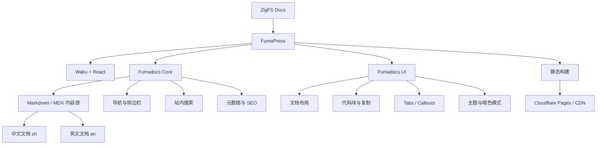

# ZigFS 文档系统架构设计

> 项目名称：`zigfs-docs`\
> 文档框架：FumaPress\
> 前端框架：Waku + React\
> 文档系统：Fumadocs\
> 内容格式：Markdown / MDX\
> 部署方式：静态构建 + CDN\
> 文档语言：中文（`zh`）与英文（`en`）

## 1. 项目目标

为 ZigFS 建立独立、可维护、可扩展的官方文档站点。文档项目与 ZigFS
核心服务及管理后台解耦，主要承载：

-   产品介绍、概念与架构说明
-   安装部署和运维指南
-   S3 API 兼容性及 API 参考
-   `zc` CLI 命令手册
-   管理中心功能说明
-   IAM、STS、KMS、SSE 等安全文档
-   配置项、环境变量、错误码和故障排查参考

项目采用静态内容构建，不引入数据库或独立业务后端。

## 2. 技术架构

### 2.1 技术选型

  层级         技术                 职责
  ------------ -------------------- --------------------------------------
  文档站框架   FumaPress            文档站点整体框架与集成
  React 框架   Waku                 页面、路由及 React 应用运行框架
  构建工具     Vite（由框架集成）   开发服务器与构建流程
  文档核心     Fumadocs Core        文档数据、内容处理、导航等
  文档 UI      Fumadocs UI          文档布局与交互组件
  内容格式     Markdown / MDX       文档源文件
  开发语言     TypeScript           配置与自定义组件
  CSS          Tailwind CSS 4       样式与主题定制
  代码高亮     Shiki（框架集成）    Zig、Rust、Go、Bash、JSON 等代码高亮
  流程图       Mermaid              架构图与流程图
  数学公式     KaTeX                数学公式渲染（需要时启用）
  包管理器     pnpm                 依赖管理
  运行环境     Node.js 22+          本地开发与构建环境
  部署         静态站点托管 + CDN   发布与访问

> 具体依赖版本、目录和命令以所选 FumaPress
> 模板当前生成结果及官方文档为准。不要在初始化前手工锁定未经模板验证的版本。

### 2.2 系统结构图



### 2.3 架构原则

1.  文档站独立于 ZigFS 主项目维护。
2.  文档内容以 Markdown / MDX 文件为主，不存入数据库。
3.  构建阶段生成可部署的站点产物。
4.  不开发专用后端 API，不引入数据库。
5.  复用 FumaPress / Fumadocs 原生能力，减少自研 UI。
6.  支持中英文内容和未来版本化文档的扩展。
7.  自定义组件仅用于 ZigFS 特有的 API 示例、CLI 示例或版本提示。

## 3. 项目目录规划

以下是建议的内容组织结构。FumaPress
模板生成的框架配置与源代码目录应优先保留；如实际模板目录不同，以模板为准。

``` text
zigfs-docs/
├── content/
│   ├── index.mdx
│   ├── en/
│   │   ├── index.mdx
│   │   ├── meta.json
│   │   ├── getting-started/
│   │   │   ├── index.mdx
│   │   │   ├── installation.mdx
│   │   │   ├── docker.mdx
│   │   │   └── quick-start.mdx
│   │   ├── concepts/
│   │   │   ├── index.mdx
│   │   │   ├── architecture.mdx
│   │   │   ├── buckets.mdx
│   │   │   ├── objects.mdx
│   │   │   ├── regions.mdx
│   │   │   └── storage.mdx
│   │   ├── s3-api/
│   │   │   ├── index.mdx
│   │   │   ├── bucket/
│   │   │   ├── object/
│   │   │   ├── multipart-upload/
│   │   │   ├── iam/
│   │   │   └── sts/
│   │   ├── cli/
│   │   │   ├── index.mdx
│   │   │   ├── installation.mdx
│   │   │   ├── configuration.mdx
│   │   │   ├── commands/
│   │   │   └── examples/
│   │   ├── administration/
│   │   │   ├── index.mdx
│   │   │   ├── users.mdx
│   │   │   ├── policies.mdx
│   │   │   ├── buckets.mdx
│   │   │   ├── kms.mdx
│   │   │   ├── audit-logs.mdx
│   │   │   └── system-logs.mdx
│   │   ├── security/
│   │   ├── deployment/
│   │   ├── troubleshooting/
│   │   └── reference/
│   └── zh/
│       ├── index.mdx
│       ├── meta.json
│       ├── getting-started/
│       ├── concepts/
│       ├── s3-api/
│       ├── cli/
│       ├── administration/
│       ├── security/
│       ├── deployment/
│       ├── troubleshooting/
│       └── reference/
├── src/
│   ├── app.css
│   └── components/
│       ├── CodeExample.tsx
│       ├── ApiExample.tsx
│       └── VersionBadge.tsx
├── public/
│   ├── logo.svg
│   ├── favicon.ico
│   └── images/
├── scripts/
│   └── docs-check.mjs
├── press.config.tsx
├── source.config.ts
├── waku.config.ts
├── tsconfig.json
├── package.json
├── pnpm-lock.yaml
├── .gitignore
└── README.md
```

> `src/` 下的文件、配置文件名及内容目录接入方式可能随 FumaPress
> 版本或模板发生变化。初始化后应根据模板实际结构映射，不应为满足此示例而覆盖框架默认配置。

## 4. 文档导航规划

建议设置以下一级导航：

  导航               内容范围
  ------------------ ----------------------------------------
  Overview           产品简介、核心特性、架构概览
  Getting Started    安装、快速启动、首次配置
  Concepts           Bucket、Object、Region、存储机制等概念
  S3 API Reference   S3 API 兼容性、请求参数、响应与示例
  CLI Reference      `zc` CLI 命令、参数、示例
  Administration     用户、策略、Bucket、密钥、系统管理
  Security           IAM、STS、KMS、SSE、TLS 等安全机制
  Deployment         Docker、单机部署、生产环境部署
  Troubleshooting    错误码、常见问题、故障排查
  Reference          配置项、环境变量、协议与兼容性参考

### 内容组织约定

-   S3 API：按 API 资源与操作分类，并明确 ZigFS 的兼容状态。
-   CLI：按 `zc` 顶级命令组织，子命令页面列出参数、示例和输出。
-   Administration：按管理中心真实模块组织。
-   Deployment：区分开发环境、单机部署和未来的多节点部署。
-   Security：明确认证、授权、加密与密钥管理各自的职责。
-   中英文目录尽量保持相同的分类和页面 slug。

## 5. 国际化规划

-   支持中文 `zh` 和英文 `en`。
-   URL 采用语言前缀，例如 `/zh/...`、`/en/...`。
-   中文与英文内容分开维护。
-   导航、页面标题和元数据应本地化。
-   页面翻译未完成时，不应自动生成误导性或不准确的翻译内容。
-   语言切换尽可能定位到同一主题的另一语言页面；若对应页面不存在，则回退到该语言首页或栏目页。

## 6. 自定义组件规划

初期只规划少量 ZigFS 专用组件：

  ----------------------------------------------------------------------------------
  组件                                用途
  ----------------------------------- ----------------------------------------------
  `CodeExample`                       展示带语言标识的 CLI/API
                                      代码示例（如原生能力不足时）

  `ApiExample`                        展示请求、响应、参数说明（如原生能力不足时）

  `VersionBadge`                      标注功能支持的 ZigFS 版本

  兼容性提示                          标注 S3 API 的支持状态、限制或差异
  ----------------------------------------------------------------------------------

优先使用 Fumadocs
原生组件；只有在原生组件无法满足需求时才新增自定义组件。

## 7. 搜索、SEO 与体验

初始化验收应包含：

-   文档站内搜索可用。
-   页面标题、描述、规范 URL 等 SEO 元数据可配置。
-   支持明暗主题。
-   支持代码高亮和代码复制。
-   支持 Mermaid 图表。
-   文档侧边栏与页面层级清晰。
-   页面在桌面和移动端均可正常阅读。
-   404 页面与站点 favicon、品牌 Logo 已配置。

搜索的具体实现、索引生成和托管限制需依据 FumaPress 模板当前版本验证。

## 8. 构建与部署

### 本地开发

使用官方初始化器创建 Waku 版本的 FumaPress 项目：

``` bash
pnpm create fumapress -- --framework waku
```

随后进入项目目录并安装依赖：

``` bash
cd zigfs-docs
pnpm install
pnpm dev
```

开发服务器端口以模板输出为准。

### 构建

``` bash
pnpm build
```

生产启动或预览命令以生成的 `package.json` scripts 为准。

### 部署原则

-   优先部署至 Cloudflare Pages 或兼容的静态站点/CDN 托管平台。
-   CI 中执行依赖安装、文档检查和构建。
-   构建失败时阻止发布。
-   文档站独立发布，不与 ZigFS 服务端或管理后台绑定发布。
-   具体输出目录和 Pages 构建设置以当前 FumaPress 模板实际产物为准。

## 9. 项目初始化约束（供 Codex 执行）

1.  使用 FumaPress 官方模板，并选择 Waku 框架。
2.  使用 TypeScript 与 pnpm。
3.  保留模板生成的原生目录结构和配置。
4.  初始化中英文文档结构。
5.  采用 Markdown / MDX 作为内容源。
6.  配置 ZigFS 品牌 Logo、favicon、站点名称和基础主题。
7.  启用或配置暗色模式、代码高亮、代码复制、Mermaid。
8.  配置文档导航与站内搜索。
9.  不引入数据库或独立业务后端。
10. 不开发 ZigFS 管理后台功能。
11. 创建基础首页、快速开始页面和各一级栏目入口页。
12. 确保本地开发与生产构建成功。
13. 对依赖版本、配置项及构建输出以模板当前版本为准，不猜测或强行覆盖。

## 10. 初始化完成验收标准

-   [ ] 项目可通过 pnpm 安装依赖。
-   [ ] 本地开发服务器能够启动。
-   [ ] 中文与英文入口页面可访问。
-   [ ] 文档侧边栏结构正常。
-   [ ] 搜索可使用。
-   [ ] 明暗主题切换正常。
-   [ ] Markdown / MDX 页面正常渲染。
-   [ ] 代码块高亮与复制正常。
-   [ ] Mermaid 图表正常渲染。
-   [ ] ZigFS Logo 与 favicon 已替换。
-   [ ] 生产构建成功。
-   [ ] 文档站可独立部署。

## 11. 官方参考资料

-   FumaPress 文档：<https://press.fumadocs.dev/docs>
-   Fumadocs 文档：<https://www.fumadocs.dev/docs>
-   RustFS 官方文档仓库：<https://github.com/rustfs/docs.rustfs.com>

------------------------------------------------------------------------

**最终建议：** 使用 FumaPress 官方 Waku
模板完成基础初始化，先验证开发、MDX
内容渲染、导航、搜索和生产构建，再逐步补充 ZigFS 的 S3 API、`zc`
CLI、管理中心和部署文档。
