# ZigFS Runtime Monitoring 技术设计文档

> ZigFS 运行时监控、性能分析、内存安全诊断与性能对比系统

- 项目名称：ZigFS
- 模块名称：Runtime Monitoring
- 文档版本：v1.0
- 文档状态：技术设计
- 目标：建立完整的 ZigFS 运行时监控与性能分析体系

---

# 1. 项目目标

为 ZigFS 构建一套完整的运行时监控、性能分析、异常检测和性能对比系统。

系统应能够在 ZigFS 正常运行期间，实时采集服务资源使用情况，并通过 Admin 管理后台直观展示运行状态。

核心目标：

1. 实时监控 CPU、内存、线程、磁盘、网络等系统资源。
2. 监控 ZigFS S3 API 请求性能。
3. 检测内存分配失败、内存泄漏风险、资源泄漏等运行时问题。
4. 支持内存安全检测、崩溃诊断和线程异常分析。
5. 提供历史指标统计和趋势分析。
6. 支持独立 ZigFS 性能测试报告，报告不进入实时监控。
7. 提供 Prometheus 指标导出能力。
8. 尽量降低正式运行环境中的监控开销。

# 2. 系统架构

## 2.1 总体架构

```mermaid
flowchart TB
    A["ZigFS Core Service"]

    A --> B["Runtime Metrics"]
    A --> C["Allocator Instrumentation"]
    A --> D["API Instrumentation"]
    A --> E["Storage / IO Instrumentation"]
    A --> F["Runtime Error Capture"]

    B --> G["Metrics Registry"]
    C --> G
    D --> G
    E --> G

    F --> H["Diagnostic Event Registry"]

    G --> I["Metrics API"]
    H --> J["Diagnostics API"]

    I --> K["ZigFS Admin"]
    J --> K

    G --> L["Metrics History"]
    H --> M["Diagnostic History"]

    K --> N["Monitoring Dashboard"]
    K --> O["Performance Statistics"]
    K --> P["Benchmark Comparison"]
```



## 2.2 核心子系统

| 子系统 | 名称 | 职责 |
|---|---|---|
| 指标采集 | zigfs-metrics | 实时采集系统及服务指标 |
| 内存监控 | zigfs-memory-monitor | 监控 Allocator 与内存使用 |
| 请求监控 | zigfs-api-monitor | 统计 S3 API 请求性能 |
| 运行时诊断 | zigfs-diagnostics | 检测运行时异常与资源泄漏 |
| 历史统计 | zigfs-metrics-history | 指标采样、存储与趋势分析 |
| 性能测试 | zigfs-benchmark | 独立 ZigFS 性能测试报告 |
| 可视化 | zigfs-admin-monitoring | Admin 监控中心 |

# 3. 指标分类

指标分为以下八大类：

1. CPU 性能指标
2. 内存与 Allocator 指标
3. 线程与并发指标
4. API 请求性能指标
5. 磁盘与文件系统指标
6. 网络与连接指标
7. 运行时安全与异常指标
8. 后台任务与资源队列指标

指标检测模式：

| 模式 | 说明 |
|---|---|
| 实时检测 | 当前运行状态，周期性采样 |
| 统计检测 | 时间窗口内的累计、平均、峰值等统计 |
| 趋势检测 | 通过历史数据分析资源变化 |
| 事件检测 | 发生异常时记录诊断事件 |
| 调试检测 | 使用 Debug Allocator、Sanitizer 等工具 |

# 4. CPU 性能监控

## 4.1 实时指标

| 指标 | 说明 | 优先级 |
|---|---|---|
| process_cpu_usage | ZigFS 进程 CPU 使用率 | P0 |
| system_cpu_usage | 系统 CPU 使用率 | P0 |
| cpu_core_count | CPU 核心数量 | P0 |
| process_user_cpu_time | 用户态 CPU 时间 | P1 |
| process_kernel_cpu_time | 内核态 CPU 时间 | P1 |
| cpu_per_core_usage | 单核 CPU 使用率 | P1 |
| context_switches | 上下文切换次数 | P2 |
| load_average | 系统平均负载 | P1 |

## 4.2 统计指标

- CPU 平均使用率
- CPU 最大使用率
- CPU P95 使用率
- CPU 使用率趋势
- 用户态 CPU 时间累计
- 内核态 CPU 时间累计
- 上下文切换频率

## 4.3 监控目的

- 判断 CPU 是否成为服务瓶颈。
- 判断是否存在单核性能瓶颈。
- 识别 CPU 使用率异常升高。
- 为独立 ZigFS 性能测试提供观测数据。

# 5. 内存监控

## 5.1 操作系统内存指标

| 指标 | 说明 | 优先级 |
|---|---|---|
| process_rss_bytes | 进程实际驻留物理内存 | P0 |
| process_virtual_memory_bytes | 进程虚拟内存 | P0 |
| process_peak_rss_bytes | 进程历史内存峰值 | P0 |
| system_memory_total_bytes | 系统总内存 | P0 |
| system_memory_available_bytes | 系统可用内存 | P0 |
| system_memory_used_percent | 系统内存使用率 | P0 |

## 5.2 Allocator 指标

| 指标 | 说明 | 优先级 |
|---|---|---|
| allocator_allocated_bytes | 当前活跃分配字节数 | P0 |
| allocator_peak_allocated_bytes | 活跃分配内存峰值 | P0 |
| allocator_allocation_count | 当前活跃分配数量 | P0 |
| allocator_total_allocations | 累计分配次数 | P0 |
| allocator_total_frees | 累计释放次数 | P0 |
| allocator_total_allocated_bytes | 累计分配字节数 | P1 |
| allocator_total_freed_bytes | 累计释放字节数 | P1 |
| allocator_allocation_failures | 分配失败次数 | P0 |
| allocator_reallocation_count | 重分配次数 | P1 |

## 5.3 内存监控要求

需要区分以下内存指标：

- RSS：操作系统视角的实际驻留内存。
- Virtual Memory：虚拟地址空间使用情况。
- Allocated Heap：Allocator 视角的活跃分配内存。
- Peak Memory：历史内存峰值。
- Allocation Count：活跃内存分配数量。

这些指标不能相互替代。

## 5.4 内存趋势检测

定期采集：

- RSS
- Heap Allocated
- 活跃分配数量
- 分配失败次数
- 内存峰值

分析：

- 内存是否持续增长。
- 请求结束后内存是否回落。
- 多轮负载测试后内存基线是否持续增加。
- 活跃分配数量是否异常增长。

注意：内存增长不一定是内存泄漏。缓存、内存池、Allocator 保留内存都可能导致 RSS 不下降。

# 6. 线程与并发监控

## 6.1 实时指标

| 指标 | 说明 | 优先级 |
|---|---|---|
| process_thread_count | 当前 OS 线程数量 | P0 |
| process_peak_thread_count | 线程数量峰值 | P1 |
| active_worker_count | 活跃 Worker 数量 | P0 |
| idle_worker_count | 空闲 Worker 数量 | P1 |
| active_request_count | 当前活跃请求数量 | P0 |
| max_concurrent_requests | 历史最大请求并发 | P1 |
| blocked_task_count | 阻塞任务数量 | P1 |
| thread_creation_total | 累计创建线程数量 | P1 |
| thread_context_switches | 线程上下文切换 | P2 |

## 6.2 诊断指标

- 线程数量异常增长
- 线程阻塞时间
- 锁等待时间
- 锁竞争次数
- 线程死锁风险
- Worker 队列积压
- 线程堆栈采集

ZigFS 使用 Zig，不应采用 Go Goroutine 监控模型。

# 7. API 请求性能监控

## 7.1 实时指标

| 指标 | 说明 | 优先级 |
|---|---|---|
| api_requests_per_second | 每秒请求数 | P0 |
| api_active_requests | 当前活跃请求数 | P0 |
| api_request_latency_avg | 平均请求延迟 | P0 |
| api_request_latency_p50 | P50 延迟 | P0 |
| api_request_latency_p95 | P95 延迟 | P0 |
| api_request_latency_p99 | P99 延迟 | P0 |
| api_request_error_rate | 请求错误率 | P0 |
| api_http_4xx_total | HTTP 4xx 数量 | P1 |
| api_http_5xx_total | HTTP 5xx 数量 | P0 |
| api_request_timeout_total | 请求超时次数 | P0 |
| api_upload_bytes_per_second | 上传吞吐量 | P0 |
| api_download_bytes_per_second | 下载吞吐量 | P0 |

## 7.2 S3 API 分类统计

| API | 请求总数 | 延迟统计 | 错误率 | 吞吐量 |
|---|---|---|---|---|
| PUT Object | 支持 | 支持 | 支持 | 支持 |
| GET Object | 支持 | 支持 | 支持 | 支持 |
| HEAD Object | 支持 | 支持 | 支持 | 不适用 |
| DELETE Object | 支持 | 支持 | 支持 | 不适用 |
| LIST Objects | 支持 | 支持 | 支持 | 不适用 |
| Create Bucket | 支持 | 支持 | 支持 | 不适用 |
| Multipart Upload | 支持 | 支持 | 支持 | 支持 |
| Complete Multipart | 支持 | 支持 | 支持 | 支持 |

## 7.3 请求统计维度

- API 操作类型
- HTTP 状态码
- 请求耗时
- 请求数据大小
- 响应数据大小
- 请求成功率
- 请求错误率
- 请求吞吐量

不得将 Access Key、Secret Key、完整对象路径等敏感数据作为 Metrics Label。

# 8. 磁盘与文件系统监控

## 8.1 实时指标

| 指标 | 说明 | 优先级 |
|---|---|---|
| storage_total_bytes | 存储总容量 | P0 |
| storage_used_bytes | 已使用容量 | P0 |
| storage_available_bytes | 可用容量 | P0 |
| storage_usage_percent | 存储使用率 | P0 |
| disk_read_bytes_per_second | 磁盘读取速度 | P0 |
| disk_write_bytes_per_second | 磁盘写入速度 | P0 |
| disk_read_iops | 读取 IOPS | P1 |
| disk_write_iops | 写入 IOPS | P1 |
| disk_io_latency | 磁盘 IO 延迟 | P1 |
| open_file_descriptors | 当前打开文件句柄数 | P0 |
| file_descriptor_limit | 文件句柄上限 | P0 |
| storage_io_errors_total | 存储 IO 错误次数 | P0 |
| storage_path_status | 存储路径状态 | P0 |

## 8.2 监控内容

- 存储路径是否正常。
- 存储空间是否不足。
- 文件句柄是否接近上限。
- 磁盘 IO 是否成为瓶颈。
- 文件读写错误是否增加。
- 是否出现文件句柄泄漏。

# 9. 网络与连接监控

| 指标 | 说明 | 优先级 |
|---|---|---|
| network_receive_bytes_per_second | 网络接收速度 | P0 |
| network_transmit_bytes_per_second | 网络发送速度 | P0 |
| network_receive_bytes_total | 累计接收字节数 | P1 |
| network_transmit_bytes_total | 累计发送字节数 | P1 |
| tcp_connection_count | TCP 连接数 | P0 |
| http_active_connections | 活跃 HTTP 连接 | P0 |
| keep_alive_connections | Keep-Alive 连接数 | P1 |
| connection_rejected_total | 连接拒绝次数 | P1 |
| network_errors_total | 网络错误次数 | P0 |
| connection_timeout_total | 连接超时次数 | P0 |

# 10. 运行时异常检测

## 10.1 内存安全问题

| 异常 | 说明 | 检测方式 |
|---|---|---|
| Memory Leak | 内存泄漏 | Allocator 跟踪、快照 |
| Allocation Failure | 内存分配失败 | Allocator 错误捕获 |
| OOM | 内存不足 | 系统事件、分配错误 |
| Null Pointer Dereference | 空指针解引用 | 代码检查、运行时崩溃捕获 |
| Use-after-free | 释放后使用 | ASan 等工具 |
| Double-free | 重复释放 | Debug Allocator、ASan |
| Buffer Overflow | 缓冲区越界写入 | ASan |
| Buffer Underflow | 缓冲区越界读取 | ASan |
| Uninitialized Memory | 未初始化内存访问 | MemorySanitizer 等工具 |
| Memory Fragmentation | 内存碎片 | Allocator 统计、分析 |
| Invalid Free | 非法释放 | Debug Allocator |

## 10.2 线程与资源问题

| 异常 | 说明 | 检测方式 |
|---|---|---|
| Deadlock | 死锁 | 锁诊断、线程堆栈 |
| Race Condition | 数据竞争 | TSan |
| Lock Contention | 锁竞争 | 锁等待时间统计 |
| Stack Overflow | 线程栈溢出 | 崩溃信号、栈检查 |
| Thread Leak | 线程泄漏 | 线程数量趋势 |
| Resource Leak | 资源泄漏 | 资源计数 |
| Connection Leak | 连接泄漏 | 连接生命周期统计 |
| FD Exhaustion | 文件句柄耗尽 | FD 数量与上限 |
| Queue Overflow | 队列溢出 | 队列容量与丢弃计数 |
| Panic / Crash | 服务崩溃 | 崩溃记录、系统日志 |
| Infinite Loop | 无限循环 | CPU Profiling、线程堆栈 |

## 10.3 Debug 检测模式

建议支持两种运行模式。

### Production Mode

低开销持续监控：

- CPU
- RSS
- Heap
- 线程数
- 请求性能
- IO 性能
- 内存分配失败
- OOM 事件
- 资源泄漏风险
- 异常退出记录

### Diagnostic Mode

调试与专项检测：

- AddressSanitizer
- UndefinedBehaviorSanitizer
- ThreadSanitizer
- Zig Debug Allocator
- 内存分配追踪
- 泄漏检测
- 崩溃堆栈
- 内存热点分析

Sanitizer 通常用于调试构建或专项测试构建，不应默认在生产环境全部开启。

# 11. 历史统计与趋势分析

## 11.1 统计时间窗口

支持：

- 最近 1 分钟
- 最近 5 分钟
- 最近 15 分钟
- 最近 1 小时
- 最近 24 小时
- 自服务启动以来

## 11.2 统计内容

| 指标 | 统计方式 |
|---|---|
| CPU | 平均值、最大值、P95 |
| 内存 | 平均值、峰值、增长率 |
| 线程 | 平均值、峰值 |
| QPS | 平均值、峰值 |
| API 延迟 | P50、P95、P99、最大值 |
| 上传吞吐量 | 平均值、峰值 |
| 下载吞吐量 | 平均值、峰值 |
| 错误率 | 总数、比例、趋势 |
| 内存分配 | 累计分配次数、字节数 |
| 内存释放 | 累计释放次数、字节数 |
| 磁盘 IO | 平均值、峰值 |
| 网络 IO | 平均值、峰值 |

## 11.3 内存泄漏趋势分析

检测流程：

1. 服务启动后记录内存基线。
2. 定期记录 RSS、Heap Allocated、活跃分配数量。
3. 进行固定负载测试。
4. 负载结束后观察内存是否回落。
5. 多轮测试比较内存基线。
6. 对持续增长的内存发出告警。
7. 必要时生成内存快照。

内存泄漏判定应采用趋势与诊断证据结合的方式，不能仅依赖 RSS。

# 12. 独立性能测试报告

本功能不属于实时监控页面，不接入任何竞品比较。`tools/monitoring/benchmark.py` 针对一个 ZigFS 实例执行签名 S3 请求，输出独立 JSON 报告。

- 请求序列：PUT、GET（验证完整载荷）、HEAD、LIST、DELETE。
- 参数：对象大小 1 B–16 MiB、对象数量 1–10000、并发 1–128。
- 每轮创建随机独立 bucket，测试后清理；报告记录清理失败，失败以非零退出码结束。
- 报告含成功 QPS、成功请求 P50/P95/P99、有效载荷吞吐、错误分类、时间、客户端平台和声明的服务版本。
- 这是客户端端到端计时，使用新 HTTP 连接、无预热，不是服务端 CPU 或磁盘性能报告。硬件、文件系统、持久化配置应由测试人员附注。
- 长时间压力测试、大文件流式压测及完整诊断报告属于后续阶段。

# 13. Admin 监控中心 UI

## 13.1 菜单结构

```text
Monitoring Center
├── System Overview
├── CPU Monitoring
├── Memory Monitoring
├── Thread & Concurrency
├── API Performance
├── Storage & Disk
├── Network Monitoring
├── Runtime Diagnostics
├── Performance Statistics
├── Benchmark Comparison
└── Alert Management
```

## 13.2 系统概览

首页展示：

### 状态卡片

- CPU 使用率
- 内存占用
- 线程数量
- API QPS
- 活跃请求数
- 上传速度
- 下载速度
- 错误率

### 趋势图

- CPU 使用率趋势
- 内存使用趋势
- 线程数量趋势
- API QPS 趋势
- P95/P99 延迟趋势
- 上传下载速度趋势

### 异常事件列表

- 内存分配失败
- 内存增长告警
- 文件句柄异常
- 存储 IO 错误
- API 错误
- 服务崩溃
- 运行时诊断事件

## 13.3 内存监控页面

建议包含：

- RSS 使用量
- Heap Allocated
- Peak Memory
- Allocation Count
- Free Count
- Allocation Failure Count
- 内存增长曲线
- 内存基线对比
- 内存快照入口

## 13.4 API 性能页面

建议包含：

- QPS
- 活跃请求数
- P50/P95/P99 延迟
- API 错误率
- S3 API 分类统计
- 上传下载吞吐量
- API 请求趋势

## 13.5 Runtime Diagnostics 页面

建议包含：

- 异常事件列表
- 事件等级
- 事件类型
- 发生时间
- 发生次数
- 诊断模式状态
- 崩溃记录
- 内存快照
- 线程堆栈
- 诊断报告

# 14. Metrics API 设计

建议使用以下接口。

| API | 方法 | 用途 |
|---|---|---|
| /admin/monitoring/overview | GET | 实时系统概览 |
| /admin/monitoring/cpu | GET | CPU 指标 |
| /admin/monitoring/memory | GET | 内存指标 |
| /admin/monitoring/threads | GET | 线程与并发指标 |
| /admin/monitoring/storage | GET | 存储指标 |
| /admin/monitoring/network | GET | 网络指标 |
| /admin/monitoring/api | GET | API 性能指标 |
| /admin/monitoring/history | GET | 历史统计 |
| /admin/diagnostics/events | GET | 运行时异常事件 |
| /admin/diagnostics/snapshots | GET | 诊断快照列表 |
| /admin/diagnostics/report | GET | 诊断报告 |
| /metrics | GET | Prometheus Metrics Exporter |

实时数据传输建议：

- REST API：首次加载与查询。
- SSE 或 WebSocket：实时指标推送。
- 历史查询 API：趋势数据查询。

# 15. 指标采集与数据存储

## 15.1 采样策略

建议初始采样频率：

| 数据类型 | 采样间隔 |
|---|---|
| CPU | 1 秒 |
| RSS / Memory | 1 秒 |
| Heap | 1 秒 |
| 线程数 | 1 秒 |
| 活跃请求数 | 1 秒 |
| QPS | 1 秒 |
| 网络 IO | 1 秒 |
| 磁盘 IO | 1 秒或 5 秒 |
| 历史统计 | 10 秒或 60 秒聚合 |
| 诊断事件 | 事件触发 |

以上采样频率可配置，应支持降低频率以减少监控开销。

## 15.2 数据存储策略

建议：

- 实时指标：内存 Metrics Registry。
- 历史指标：轻量级本地存储。
- 诊断事件：本地事件记录。
- Benchmark 报告：独立报告存储。
- Prometheus：通过 Exporter 提供外部采集。

不要每秒将全部指标直接写入 PostgreSQL。

建议使用采样、聚合和批量持久化策略。

# 16. 告警系统

## 16.1 告警等级

| 等级 | 说明 |
|---|---|
| Info | 普通运行事件 |
| Warning | 资源异常趋势 |
| Error | 运行时错误 |
| Critical | 服务稳定性受到严重影响 |

## 16.2 建议初始告警规则

| 告警 | 默认触发条件 |
|---|---|
| CPU High | CPU > 90% 持续 60 秒 |
| Memory High | RSS > 配置阈值 |
| Memory Growth | 内存持续增长且超过阈值 |
| Allocation Failure | 出现内存分配失败 |
| Thread High | 线程数量超过配置阈值 |
| FD High | 文件句柄使用率 > 80% |
| Storage Low | 存储剩余空间低于阈值 |
| API Error High | 5xx 错误率超过阈值 |
| API Latency High | P99 超过阈值 |
| IO Error | 出现存储 IO 错误 |

所有阈值均应可配置。

# 17. 实现优先级

## P0：第一阶段

实现基础运行时监控。

- CPU 使用率
- RSS
- Heap
- Peak Memory
- Allocation / Free 统计
- Allocation Failure
- OS 线程数量
- Worker 数量
- 活跃请求数
- QPS
- P50/P95/P99
- API 错误率
- 上传下载吞吐量
- 磁盘容量
- 磁盘 IO
- 文件句柄
- 网络 IO
- Metrics Registry
- Prometheus Exporter
- Admin 系统概览
- 历史统计

## P1：第二阶段

已按第 22 节实际契约完成性能分析与稳定性诊断。

- [x] 内存增长趋势分析（不直接判定泄漏）
- [x] 线程堆栈（本机原生工具）
- [x] CPU Profiling（本机原生工具）
- [x] 内存分配热点（按需启用）
- [x] 锁竞争分析
- [x] 资源持续增长诊断（FD / 活跃分配）
- [x] 告警管理
- [x] S3 API 分类统计
- [x] Benchmark 自动化
- [x] 独立 ZigFS 性能测试报告（不进入实时监控；取消竞品对比需求）

## P2：第三阶段

已按第 24 节列明的检测范围完成专业诊断工具，并通过 macOS 本机验收。Ubuntu 24.04 ARM64 的实测范围与结果见第 26 节。

- [x] ASan（C 桥接与阳性对照）
- [x] UBSan（C 桥接与阳性对照）
- [x] TSan（C / Zig 对照及服务端集成）
- [x] Debug Allocator（Zig 0.17 SafeAllocator）
- [x] Use-after-free 检测（已验证释放后写入）
- [x] Double-free 检测
- [x] Buffer Overflow 检测（边界/分配尾部破坏）
- [x] 内存快照（OS、分配器聚合、原生内存 core）
- [x] 崩溃 Dump
- [x] 符号化堆栈
- [x] 长时间压力测试（30 分钟实测）
- [x] 自动生成诊断报告

# 18. 设计原则

1. 正式运行模式下监控开销必须尽可能低。
2. 监控系统不能阻塞核心 S3 请求处理。
3. 指标采集应采用线程安全设计。
4. 指标采集失败不得导致 ZigFS 主服务崩溃。
5. 历史数据应采用低频采样与聚合。
6. Metrics Label 必须控制基数。
7. 敏感认证信息不得出现在监控指标中。
8. Debug 诊断功能应与 Production 监控分离。
9. 性能测试报告必须记录测试环境与工作负载。
10. 所有资源阈值均应可配置。
11. 监控模块应支持平台差异化实现。
12. 不应将 RSS 下降作为唯一内存泄漏判定标准。

# 19. 最终目标

ZigFS Runtime Monitoring 最终应实现：

- 服务运行状态实时可视化。
- CPU、内存、线程、磁盘、网络全面监控。
- S3 API 请求性能统计。
- 内存泄漏风险检测。
- 运行时异常事件记录。
- 资源泄漏诊断。
- 历史性能趋势分析。
- Prometheus 兼容指标输出。
- 独立 ZigFS 性能测试报告。
- 可生成完整的 Benchmark 报告。
- 支持 Debug 与 Production 两种监控模式。

最终形成一套适用于 ZigFS 单机对象存储服务的完整运行时监控与性能诊断系统。

# 20. P0 实施记录（2026-11-16）

本次按确认范围实现 P0。上文保留为路线图；P1 的后续实施范围见第 22 节，P2 尚未实施。以下为当前代码的实际契约，优先用于部署与验收。

## 20.1 数据链路与权限

- ZigFS 负责采集、累计计数器、固定桶延迟直方图和有界历史；Go BFF 仅转发 JSON 与会话，不读取数据目录，也不采集 BFF 主机指标。
- 新增 `GET /_admin/v1/monitoring?seconds=3600`，BFF 路径为 `GET /api/v1/monitoring?seconds=3600`。上游要求 `admin:ServerInfo`，资源为 `arn:aws:s3:::*`；未登录返回 401，无权限返回 403。诊断角色可以访问，不依赖用户列表或配置管理权限。
- `seconds` 限定在 60–86400 秒；缺省或无法解析时使用 3600 秒。返回 `version`、`started_at`、采样/历史间隔、`latest`、`history`、S3/管理 API/列表操作累计统计及固定枚举的 S3 操作明细。未采样或不支持的测量返回 `null`。
- `latest` 为最新采样；`history` 为按时间顺序的历史点，最多 361 点；长窗口抽稀，实际步长由 `history_step_seconds` 返回。抽稀不是全窗口聚合，可能不显示所有短时峰值。需要完整时间序列时使用 Prometheus。
- 常规监控刷新不调用原 `/system` 的对象元数据全量扫描。原容量扫描、恢复与索引诊断保留在可展开区域，仅展开后请求。

## 20.2 指标口径

| 指标 | 实际来源与口径 |
| --- | --- |
| 主机 CPU | Linux `/proc/stat`；macOS `host_statistics`；所有逻辑 CPU 的忙碌比例，0–100% |
| 进程 CPU | 累计进程 CPU 秒 / 单调时间差；100% 表示一个逻辑 CPU，可超过 100% |
| 主机内存 | Linux MemTotal/MemAvailable；macOS hw.memsize、free+inactive 页（可用量估算，不等同于 Linux MemAvailable） |
| RSS / 虚拟内存 / 峰值 RSS | 进程 OS 查询；虚拟地址空间不是实际物理内存用量 |
| Heap / Heap Peak | Application 跟踪分配器的当前及峰值申请字节；不包含 libc、启动 arena、运行时内部或绕过该分配器的分配，不是 RSS 的别名 |
| Allocation / Free / Failure | 成功分配、释放及分配失败的累计次数；原位 resize/remap 调整 live bytes；拒绝原位 resize 不是 OOM |
| OS 线程 | ZigFS 进程线程数 |
| Worker | Zig 0.17 `std.Io.Threaded` 实际 Worker 链表及受锁保护的 busy count；包含后台任务，不等于请求数；未知 Io 实现返回 null。适配器升级 Zig 时需要复核 |
| 活跃请求 / 连接 | HTTP 请求处理区间及连接处理生命周期的真实计数 |
| QPS / 错误率 | 已完成 S3 请求的采样差值，4xx 与 5xx/传输失败分开；无完成请求时错误率为 null，不宣称 0% |
| P50 / P95 / P99 | 完整请求耗时的直方图区间上界估计，包含请求体流式传输；桶上界为 1/5/10/25/50/100/250/500/1000/2500/5000/10000/30000 ms；溢出分位数显示 null，Prometheus 保留 +Inf 桶 |
| 上传吞吐量 | 成功写入的 PUT、POST 表单对象和上传 part 载荷，不包含 CopyObject、CopyPart 或 multipart complete 的重复字节；后续标签/响应失败不撤销已落盘载荷计数 |
| 下载吞吐量 | 完成响应流的 GET 字节；Range 按实际范围；中断响应未完成的部分不计入；不是网卡流量 |
| 磁盘容量 | 数据根目录所在文件系统 fstatvfs/statvfs，用量包括该文件系统的其他文件，不等于逻辑对象字节 |
| 磁盘 I/O | Linux `/proc/self/io`、macOS proc_pid_rusage 的进程物理 I/O 字节差；不是块设备 busy%/IOPS |
| 文件描述符 | 进程实际打开的 FD 及软上限；Linux 排除统计时临时打开的目录 FD |
| 网络 I/O | 主机非回环接口累计字节差；包括其他进程流量；Linux 为进程所在网络命名空间，不是 ZigFS 独占网卡数据 |

重置、不可用计数器、非正时间差、采样大幅中断均不生成伪造速率。所有明细标签来自固定 S3 operation 枚举，不把 bucket、key、路径、用户、凭据放入指标标签。

## 20.3 采样与历史

- 默认每 1 秒采样；`ZIGFS_MONITORING_INTERVAL_SECONDS` 支持 `1`、`2`、`5`、`10`，在服务启动时读取；其他值拒绝启动。
- 每约 10 秒记录一次历史：CPU、I/O、QPS、吞吐量与延迟直方图使用完整区间的计数器差；内存、FD、连接、线程等 gauge 使用区间末值。使用单调时钟计算速率，墙钟用于图表时间。
- 历史环形缓冲最多 8640 条，查询仅返回最近 24 小时范围内的记录；页面关闭/暂停不会停止服务端采集。
- **历史已增加本地快照持久化**：每分钟原子保存至数据根目录的 `.zigfs/monitoring/history-v1.json`，重启时恢复最近 24 小时。最近尚未保存的一分钟可能丢失；长期保留仍建议 Prometheus。
- Web 每 5 秒刷新；支持暂停、手动刷新、5m/15m/1h/6h/24h 范围；保留失败前数据并标记过期，错误使用全局 toast；缺失采样区间不连线，初次无数据不绘制示例曲线。

## 20.4 Prometheus

沿用现有独立 `/metrics` 监听地址与启停配置，默认仅监听回环地址，不额外增加公网入口。新增进程/主机资源、分配器、对象载荷计数器、Worker 与请求延迟 histogram。

请求系列通过 `scope` 区分：`api` 为 S3/management 聚合；`operation` 为 S3 操作明细；`internal` 为列表子操作。**不要跨 scope 求和，否则会重复计数。** 示例：

```promql
sum(rate(zigfs_requests_total{scope="api",operation="s3"}[5m]))
histogram_quantile(0.95, sum by (le) (rate(zigfs_request_duration_seconds_bucket{scope="api",operation="s3"}[5m])))
rate(zigfs_object_upload_bytes_total[5m])
```

不可用的可选指标不输出，不能将缺失解释为 0。`zigfs_monitor_sample_timestamp_seconds` 用于检查采样新鲜度。

## 20.5 页面与验收

UI 使用现有 shadcn/ui Card、Select、Button、Badge、Collapsible、Table 和 Chart/Recharts，遵循参考图的紧凑仪表盘布局：顶部资源仪表与数值卡片，CPU/内存/磁盘/网络趋势，S3 RED 与吞吐图，操作统计表，折叠诊断。支持中英文、明暗主题和窄屏布局。所有展示值来自上述真实数据源。

自动检查：

```sh
cd zigfs && zig build test install --summary all
cd zigfs-admin/server && go test ./...
cd zigfs-admin/web && corepack pnpm run test:i18n
corepack pnpm run build
node --test scripts/monitoring.test.mjs
```

重点回归：直方图累计和溢出、计数器重置/采样间隔、10 秒内突发请求、环形历史排序/边界、分配失败/live bytes、BFF 参数/会话转发、未登录拒绝访问、诊断角色权限、真实 PUT/GET/Range 字节统计、暂停/恢复/切换时间范围、失败 toast 与旧数据保留、移动端无横向溢出。

本地真实服务回归（临时数据目录和随机会话凭据，不使用现有实例）：

```sh
# 仓库根目录
(cd zigfs-admin/server && go build -o /tmp/zigfs-monitor-admin ./cmd/admin)
python3 conformance/monitoring_runtime.py --admin-bin /tmp/zigfs-monitor-admin
```

浏览器回归脚本为 `zigfs-admin/web/scripts/monitoring.browser.mjs`；可设置 `MONITOR_BROWSER_SCRIPT` 为该脚本绝对路径、`MONITOR_PLAYWRIGHT_MODULE` 为本地 Playwright 模块路径、`MONITOR_CHROME` 为 Chrome 可执行文件路径，再运行上述 conformance。截图写入测试临时目录，测试结束自动停止服务。

验证结果：Zig 346 项测试通过，Go 全套测试通过，前端构建与 10 项 i18n / 2 项监控数据处理测试通过；Linux C 采集器交叉编译通过。真实服务回归验证了 15 个 S3 请求、包含 Range 的上传下载字节、4xx 计数、直方图、Worker、历史记录与权限；浏览器验证了图表、暂停刷新、范围选择、错误恢复及移动端布局。


# 21. P0 历史持久化

- ZigFS 自己读写 `.zigfs/monitoring/`，BFF 保持转发模式。存储文件 `history-v1.json` 包含版本号与历史点，不包含认证信息、请求路径或对象内容。
- 首次采样后保存一次，随后每约 60 秒保存；快照从锁保护的环形历史复制，磁盘 I/O 在锁外执行。只存最近 24 小时、最多 8640 条，不持久化实时计数器和速率计算基线。
- 使用固定临时文件 `history-v1.tmp`，写入、fsync 后原子 rename，再同步父目录。单份快照上限 16 MiB，正常写入峰值最多 32 MiB；不会不断积累备份文件。启动清理遗留临时文件；每次保存剔除过期记录，读取时也剔除过期及未来时间记录。
- 超大、JSON 损坏、版本不支持、乱序或无效数值快照会被忽略并记录日志，服务继续采样。存储写入失败时保留旧的已提交快照，每分钟重试；实时监控和对象 API 继续工作。
- `persistence.state` 为 `pending / healthy / unavailable`，`last_saved_at` 为本进程最近一次成功写入的 Unix 秒。页面显示保存状态；`healthy` 不保证最后一分钟的采样已经落盘，也不保证停机前强制保存。
- 历史点新增 `run_id`（采样器启动 Unix 毫秒）。重启恢复旧历史但不恢复 live gauges、S3 累计计数器、分配器计数或 CPU/I/O 差分基线；前端在不同 run_id 之间断开曲线。
- 固定文件预算约束本程序写出的快照，不是文件系统配额；外部写入的异常超大文件会被限长读取拒绝，并在下一次成功保存时替换。

持久化回归：`python3 conformance/monitoring_runtime.py --admin-bin /tmp/zigfs-monitor-admin --persistence`。该测试等待实际周期快照，重启 ZigFS 验证历史连续与计数器归零，再注入损坏快照验证服务仍可启动。

本阶段验证：Zig 352/352 项测试通过；前端生产构建、10 项 i18n 与 3 项监控数据处理测试通过；真实周期快照、重启恢复、计数器归零、损坏快照启动恢复及浏览器交互回归通过。另覆盖超大文件拒绝、解析阶段记录数限制、过期清理与写入失败后旧快照保留。


# 22. P1 实施范围与实际契约

本轮按第 17 节 P1 清单实现性能分析与稳定性诊断，取消竞品对比。表格中早期设想的单核 CPU、设备 IOPS/延迟、完整线程创建与阻塞任务追踪并未伪造为实测值，也不属于本轮实现的诊断范围。

## 22.1 增长分析与告警

- RSS、Application heap、FD、活跃分配数使用本次进程最多 15 分钟的连续历史；至少 20 点、跨度至少 300 秒，超过 30 秒的断档或重启会切断证据。
- 返回线性回归的每小时变化率、窗口净增长、上升占比及样本数量。至少 80% 相邻点上涨且超过对应门槛才标为持续增长（RSS 32 MiB、heap 16 MiB、FD 32、活跃分配 1024）。持续增长不是泄漏证明；稳定状态也不保证没有泄漏。
- 固定 10 条告警覆盖 CPU、RSS、堆增长、FD 增长/占用率、存储剩余比例、线程数、S3 5xx/传输错误率、P99、每采样分配失败增量。阈值、持续时间（0–3600 秒）、启用状态、严重度可配置。严重度为 info/warning/err/critical。
- 超阈值触发，存储剩余比例为低于阈值触发；持续时间内缺失数据或采样中断会重置计时。状态为 disabled/no_data/normal/pending/firing。无请求时错误率与延迟是无数据。
- 规则保存到 `.zigfs/monitoring/rules.json`，原子写入并同步；读取上限 8 KiB。保存失败不更新内存规则，重启读取失败则日志警告并回退默认值。
- 确认只作用于当前 firing 告警；恢复或新一轮触发清除确认。最近 128 条触发/退出 firing 事件有界保存在内存，重启丢失；规则保存重新初始化评估计时，不构造恢复事件。
- 诊断读取角色可以看到分析、规则、告警和锁统计。`GET/PUT /_admin/v1/monitoring/diagnostics`（BFF 对应 `/api/v1/monitoring/diagnostics`）要求 `admin:*`；用于热点读取/启停、完整规则更新及告警确认。BFF 不读写 ZigFS 数据目录。

## 22.2 锁与分配热点

- 元数据锁、身份/策略锁记录获取次数、竞争次数、当前等待数、累计/最大等待纳秒。等待包含调度延迟，不代表持锁时间；其他锁不在范围内。
- Application allocator 新增累计分配/释放字节与 resize/remap 次数；用户态和内核态 CPU 为进程累计秒。
- 热点默认关闭。开启后以固定 64 槽记录调用返回地址及累计分配/增长次数和字节；槽满或地址未知计入遗漏次数。关闭后保留计数，重启清空且关闭采集。
- 热点为分配流量，不是存活对象列表或泄漏定位；不覆盖 libc/启动 arena/绕过 Application allocator 的分配。采样结果为原子字段的近似快照，不保证所有字段同一瞬间一致。启用会引入每次分配最多 64 槽扫描，建议仅在诊断期间打开。
- 返回 build commit 与原始地址，完整自动符号化属于 P2。进程地址受 ASLR 影响，离线解析需匹配二进制、符号及加载地址。
- Prometheus 增加累计用户/内核 CPU、分配/释放字节、resize 次数，固定锁名称的竞争计数和等待时间，以及固定规则名称的 firing gauge。原始地址不作为指标标签导出。

## 22.3 S3 分类与界面

操作表展示固定 operation 的累计请求、4xx、5xx/传输失败、P50/P95/P99 上界估计及上传/下载载荷；计数在进程重启时归零。仪表盘上方图表仍显示采样区间值，两者窗口不同。载荷口径沿用第 20.2 节。

界面复用 shadcn/ui，支持中英文、明暗主题和窄屏；提供规则编辑、确认、事件查看、增长证据、锁统计与管理员按需加载热点。失败反馈走全局错误 toast，保存失败保留草稿。

## 22.4 原生诊断工具

```sh
python3 tools/monitoring/capture.py --pid <zigfs-pid> --kind cpu --seconds 5 --output /tmp/zigfs-cpu-new
python3 tools/monitoring/capture.py --pid <zigfs-pid> --kind threads --output /tmp/zigfs-threads-new
```

输出目录必须不存在。macOS 使用 `sample` 输出线程调用树；Linux CPU 使用 `perf record/report`，线程使用 `gdb thread apply all bt`。工具在本机执行，不暴露远程进程控制接口。gdb 附加期间会短暂停止进程，需要相应 ptrace/perf 权限与匹配符号。工具缺失、权限失败、超时均报错，不输出假 profile；清单及日志保留在输出目录。

## 22.5 独立压测工具

目标文件示例（只接受一个目标，凭据仅通过环境变量读取）：

```json
[{"name":"ZigFS","endpoint":"http://127.0.0.1:9000","access_key_env":"ZIGFS_ACCESS_KEY","secret_key_env":"ZIGFS_SECRET_KEY","version":"填写实际构建版本"}]
```

```sh
python3 tools/monitoring/benchmark.py --targets /tmp/zigfs-target.json --output /tmp/zigfs-report-new.json --size 65536 --count 100 --concurrency 4
```

压测会向指定实例写入随机独立测试 bucket；应使用测试实例或明确预留测试容量。报告不进入实时监控，也不自动把客户端耗时归因到服务端。

## 22.6 验证

`conformance/monitoring_runtime.py --admin-bin /tmp/zigfs-monitor-admin --p1` 在隔离实例验证诊断权限、非法规则拒绝、真实告警触发与确认、规则重启恢复、热点默认关闭和真实分配、操作载荷统计、独立压测清理及原生 CPU/线程捕获。浏览器脚本额外覆盖配置校验、失败 toast/草稿保留、保存与热点开关；基础明暗主题、语言、移动端检查继续执行。


本轮验证结果：361/361 Zig 测试、Go 全套测试、前端生产构建、10 项 i18n 和 4 项监控数据处理测试通过；OpenAPI YAML 及本地引用检查通过。隔离真实服务的 P1 验证通过，独立压测的 PUT/GET/HEAD/LIST/DELETE 各 8 次成功且完成清理；macOS 原生 CPU/线程采样生成真实调用树。浏览器验证 8 张图表、暂停/恢复/范围切换、规则校验、失败草稿保留、热点开关、只读角色无写入控件、中英文、明暗主题及手机无横向溢出，无 JavaScript 错误。当时尚未进行 Linux 实测；后续 perf/gdb 与 P1 完整 Linux 验证结果见第 26 节。

# 23. P2 第一批：诊断构建与内存故障探针

本节记录 P2 第一批，当时尚未全部完成；最终实施与验收见第 24 节。第一批建立可验证的诊断基础，使用工具链实际支持的能力，不将开关存在视为检测通过。

- 新增 `-Ddiagnostic-allocator=true`，在 Debug/ReleaseSafe 下为 Application allocator 启用 Zig 0.17 的 `SafeAllocator`（旧 DebugAllocator 的当前替代实现）、16 层分配堆栈及释放后写入检查。默认构建继续使用原 SMP allocator。
- 新增 `-Dsanitize-c=off|trap|full` 和 `-Dsanitize-thread=true` 构建选项。C 检查不是 Zig ASan；TSan 尚未做平台实测，不宣称支持矩阵已完成。当前工具链没有通用 Zig ASan 开关。
- `memory-diagnostic-probe` 为独立可执行文件，不进入服务端路由或普通单元测试。正常释放、泄漏、double-free、释放后写入、分配尾部越界写五种情况已在 macOS ARM64 实测，全部达到预期；错误日志包含源文件与调用堆栈。
- `tools/diagnostics/check_memory.py` 逐个启动子进程，禁用其 core dump，每例超时 20 秒；同时核对退出状态和预期诊断内容，生成 JSON 与 Markdown 证据报告。此报告仅覆盖故障探针，不是综合服务诊断报告。
- 分配器不覆盖 libc、预编译库、启动 arena 等；不保证检测所有非法读写。泄漏检查只在正常栈退出时执行，信号终止和崩溃不能保证运行 defer；不把故障探针结果当作服务端无泄漏证明。
- 诊断版（SafeAllocator + C full 检查）已通过临时实例的真实 PUT/GET/Range、指标、历史及权限回归。

使用方法与限制见 `tools/diagnostics/README.md`。后续仍需：ASan/C 桥接验证、UBSan/TSan 故障阳性对照与平台矩阵、内存快照、崩溃 Dump、离线符号化、长时间压力测试及综合诊断报告。这些项目在后续第 24 节完成，并按实际平台和检测范围验收。


# 24. P2 完整诊断工具与验收

P2 剩余能力现已落地为独立本机工具，实时监控页面保持原有职责。运行不需要 Docker 或任何镜像；本节记录最初的 macOS 验收，后续 Ubuntu 24.04 ARM64 容器实测见第 26 节。

## 24.1 检测范围与工具链支持

| P2 项目 | 实现与证据口径 |
| --- | --- |
| ASan | Clang 独立编译真实 C 主机/进程/文件系统采集桥接；正常并发执行及 UAF、越界、double-free 阳性对照。不是全 Zig 服务的 ASan |
| UBSan | C 桥接正常执行及有符号溢出阳性对照；另验证 Zig 的 `sanitize-c=full` 诊断版真实 S3 集成 |
| TSan | C 桥接并发与竞争阳性对照；Zig 加锁/故意竞争计数器对照；完整 ZigFS TSan 构建及真实 S3 集成 |
| Debug Allocator | 使用 Zig 0.17 SafeAllocator，捕获 16 层调用栈和延迟释放后写入检查；普通构建仍使用 SMP allocator |
| UAF / Double-free / Overflow | 独立 Zig 子进程故障探针验证释放后写、重复释放和分配尾部越界，不宣称覆盖所有非法读写 |
| 内存快照 | OS 内存映射 + 可选 BFF 分配器实时样本；同 run_id 前后差值；另提供包含可写内存的原生 core |
| 崩溃 Dump | LLDB 启动复现程序，在真实 signal/exception 时保存 core 和线程/模块元数据；正常退出不伪装为崩溃 |
| 符号化堆栈 | 使用原始 file address 和匹配二进制的 DWARF 离线解析，校验 SHA-256；支持原始运行地址显式提供 ASLR slide |
| 长时间压力测试 | 默认 30 分钟，可配置至 24 小时；持续签名 PUT/GET/HEAD/DELETE、验证载荷、10 秒资源采样及测试桶清理 |
| 自动诊断报告 | 汇总真实检测结果、平台、证据哈希、压测耗时、延迟区间、错误及资源变化；缺失/失败证据使报告失败 |

macOS ARM64 上各检测阳性对照与正常对照均已实测。当前 Zig 没有通用 ASan 开关；预编译 curl 等库不在 C 检测范围。Linux 的 Clang/LLDB/perf/gdb 支持取决于工具链和主机权限；第 26 节记录独立 Linux 实测，不从 macOS 结果推断其他平台通过。

## 24.2 文件与入口

- `tools/diagnostics/check_memory.py`：独立内存故障验证，原始日志 + JSON/Markdown。
- `tools/diagnostics/check_thread.py`：独立 Zig TSan 正常/竞争验证。
- `tools/diagnostics/sanitizers.py`：ASan/UBSan/TSan 分开编译执行，生成实际平台支持矩阵。
- `tools/diagnostics/snapshot.py`：进程可执行文件核对、OS 内存映射、可选 BFF 样本、同一运行的前后差值。
- `tools/diagnostics/dump.py`：原生 crash/attach core，支持 stack / modified-memory / full 三种格式范围。
- `tools/diagnostics/symbolize.py`：不启动目标进程的离线符号解析；不匹配的二进制直接拒绝。
- `tools/diagnostics/stress.py`：有界持续读写与采样；中断、请求失败、内容不一致、采样失败或清理失败均非零退出。
- `tools/diagnostics/report.py`：JSON/Markdown 综合报告；原始 core 不复制到汇总目录。
- `conformance/diagnostics_runtime.py`：临时 ZigFS/BFF、随机测试凭据、全流程串联；core 捕获位于压测区间之外。

完整命令、依赖、平台支持及参数见 `tools/diagnostics/README.md`。无远程任意进程控制接口，不读取或修改现有实例数据，不加载仓库 `.env`。

## 24.3 转储与报告边界

- OS snapshot 是区域统计，不是假造的对象级 heap graph；需要原始内存时使用 core。`modified-memory` 包含可写/修改页，`stack` 不包含大部分 heap，`full` 可能达到数 GiB。
- 默认 core 文件预算 1 GiB，可显式调整至最多 16 GiB。超限保留错误/堆栈证据，删除不完整 core，绝不标为成功。实测 1 GiB full 超限路径后，目标正确 detach 恢复；modified-memory 捕获成功。
- 诊断 core 可能包含凭据和对象内容，输出目录权限 0700、文件 0600；应本地保管。工具不上传、发布或自动发送报告。
- 资源差值遇到重启或无样本时不比较；稳定趋势、通过探针、有限时长压测均不是无泄漏/无竞争证明。
- 内存故障探针仅在隔离子进程运行，普通单元测试与 HTTP API 不触发故障；信号退出不保证执行 allocator 的 defer 泄漏检查。

## 24.4 验证记录

默认 Zig 361 项测试通过。诊断工具 9 项自动测试覆盖失败报告、不完整 core、二进制哈希不匹配、损坏快照、跨重启比较、载荷错误与清理、有效压测时长和分位数溢出。正常内存探针及四种内存故障均通过；C ASan/UBSan/TSan、Zig TSan 对照通过。完整 SafeAllocator + C full 诊断版和完整 TSan 版均通过隔离的真实 S3/监控回归。原生 crash core 已重新载入并获得源码堆栈，离线符号化成功解析目标模块的 12 个地址。全流程短时验收已验证快照前后比较、活进程 core、清理和综合报告链路。


最终 30 分钟验收：实际负载持续 1800.22 秒，PUT/GET/HEAD/DELETE 各 15,735 次，总计 62,940 次操作，零请求/载荷错误；181 次资源采样无失败，测试桶清理成功。最终综合报告所有必需证据齐全，状态 PASS。此前受 core 捕获暂停干扰的测试明确记录为中断/失败，未作为这次通过证据。

资源报告保留实际首尾、最小/最大值：本次诊断版冷启动 RSS 约 10.9 MiB，末次负载采样约 389.4 MiB，峰值约 646.3 MiB；Application heap 末值约 218.1 KiB。首尾包含冷启动到持续负载的变化，末样本仍可能存在在途工作，没有执行停载后长期冷却观察，因此这些数值既不能证明泄漏，也不能证明无泄漏。本轮验收通过指工具与限定负载检查通过，不代表所有运行期资源问题已排除。


# 25. 监控展示修正

- 图表悬停时间读取原始 observation 的 Unix 秒时间戳，不再把 shadcn tooltip 提供的系列显示名称当作日期；非法/缺失时间显示 `—`。提示值统一精度、单位与标签间距。
- 半圆仪表按真实百分比绘制单段弧线，0/未知不绘制进度；低值不再通过零长度圆端虚线在两端生成圆点。
- 请求延迟/错误率空态明确其 S3 口径：Admin 轮询不计入已完成 S3 请求，无请求时保留 null；有请求但缺少有效观测或延迟超出 30 秒直方图上界时单独说明。真实对象操作后的历史指标继续按实际样本显示。
- 审计新增 `GetMonitoring`、`GetMonitoringDiagnostics`、`UpdateMonitoringDiagnostics`，分别正确标识只读/写入。历史 UnknownOperation 在页面上按精确 method/path 给出识别提示，原始审计记录和下载过滤语义保持不变。
- 页面按资源概览、资源趋势、S3 性能、请求统计、资源增长、告警、锁竞争、分配诊断及高级诊断分组，资源概览初始展开，其余默认收起，标题采用紧凑行高与间距并显示面板数量；刷新和语言切换保留当前展开状态。折叠告警标题保留 firing 数量，图表和高级诊断按展开挂载。


# 26. Ubuntu 24.04 ARM64 实测（2026-11-16）

结论：基础监控、P1、P2 工具与真实服务回归通过。用户接受环境中断后补跑剩余时长的结果，30 分钟验收项按此例外关闭；实测证据仍为分段累计 1800.83 秒，不改写为连续运行。SafeAllocator 配置下的 RSS 持续增长已定位并修复，回归证据见第 26.4 节。

## 26.1 环境与范围

- `ubuntu:24.04` ARM64 隔离容器，OrbStack Linux `7.2.9-orbstack-00391-g2b298d05fbd4`，glibc 2.39。不是 x86_64 或裸机验收。
- Zig 0.17.0 Linux 工具链下载后校验 SHA-256：`9e8d11661d4ae3bd57702a3832781e23ad151dde5798e16a5ccd503f65234ff8`。Clang / LLDB 18、GDB 15.1、perf 6.8.12；源码副本和编译缓存位于容器中，测试不使用既有部署数据或仓库 `.env`。
- 容器启用 `SYS_PTRACE`、`PERFMON` 与 `seccomp=unconfined`。使用 Ubuntu 实际安装的 perf 程序，绕过要求匹配 OrbStack 内核包的包装器；不修改宿主内核参数。
- `DEBUGINFOD_URLS=` 禁用远程符号下载，保留本地 DWARF 解析。未禁用时 Ubuntu debuginfod 网络等待曾使故障探针超时，该轮不计通过。
- 本轮代码以实际编译副本为准；`source-sha256.txt`、`binary-sha256.txt`、`environment.txt` 记录源码、二进制与环境。仓库同期的界面修改不在 Linux 原生工具验证范围内。

## 26.2 已完成验证与修复

| 检查 | Linux 实测结果 |
| --- | --- |
| Zig 单元与契约测试 | 修复后 362/362 通过 |
| BFF Go 测试 | Ubuntu 原生 `go test ./...` 全部通过 |
| 诊断工具自动测试 | 9 项通过；新增 perf 结果校验 4 项通过 |
| SafeAllocator | 正常、泄漏、double-free、释放后写、分配尾部破坏全部符合预期 |
| C ASan / UBSan / TSan | 真实采集桥接正常对照与各故障阳性对照全部通过 |
| Zig TSan | 加锁与竞争对照通过，完整 TSan 服务通过真实 S3 / 监控回归 |
| SafeAllocator + C full 服务 | 真实 PUT/GET/Range、指标、历史、权限及独立压测通过 |
| P1 / 持久化 | 告警触发/确认、规则恢复、热点、操作统计、周期快照、重启计数器归零与损坏快照恢复通过 |
| Linux perf / GDB | P1 在真实签名 GET 负载下取得 480 个 CPU 样本，解析 ZigFS 调用栈；GDB 取得线程堆栈并正常 detach |
| 内存与 core | `/proc` 快照与同进程前后比较、崩溃 core、活进程 modified-memory core、core 重载与 16 个地址离线符号化通过 |
| core 文件预算 | 1 MiB 超限正确失败、删除残缺文件，目标仍能响应 HTTP；提高预算后重试成功 |
| 全流程短测 | 实际 10.15 秒，948 次操作，报告 PASS；不算作 30 分钟验收 |

Linux 验证发现并修复三处问题：

1. KMS 新建密钥使用 `.replace = false` 创建原子文件，却调用 `replace()` 提交，在 Linux 上触发断言。新建改为 `link()`，更新继续使用 `replace()`，保留禁止覆盖的语义；现有密钥创建/轮换回归通过。
2. 越界探针原来写入零，若尾部原字节恰好为零则未真正破坏元数据。改为翻转字节后，Linux 与 macOS 的五种内存探针均通过。
3. perf 无样本时也可能退出 0，原脚本会误报成功。现在通过 `perf script` 验证实际样本，清单记录 `passed` 与样本数；失败保持 `passed=false`。P1 脚本在 CPU 采样期间产生并校验真实 GET 负载。

长测入口增加 `--core-max-mib`（默认 1024，范围 1–16384），转储报告记录实际预算。本次重跑显式使用 4096 MiB；未改变默认限制或证据通过条件。

## 26.3 持续负载与证据

验收决定：用户于本次复核明确接受分段补足结果，免除再次连续重跑；此项不再作为功能交付遗留。该决定不改变下述实测时长、中断原因或各段报告。

两次连续 30 分钟尝试分别在最后观测 1060.74 秒和 1721.68 秒后被 OrbStack 关闭虚拟机打断，均未生成完成的 stress 报告，不计为连续验收通过。宿主日志显示许可证接口 `api-license.orbstack.dev` 请求超时，随后出现 `deadline reached - power off`；容器没有 OOM 标记。原始日志摘要保留在 `orbstack-interruption.log`。

按用户要求不再重跑 30 分钟，仅补跑剩余 79 秒。实际补跑 **79.15 秒**，PUT / GET / HEAD / DELETE 各 **1,839 次**，合计 **7,356 次**，零请求/载荷错误，9 次资源采样无失败，测试桶清理成功。结束快照、同进程比较、活进程 modified-memory core（789,761,265 字节）、符号化及综合报告均通过；该报告明确记录请求时长 79 秒，不标为 1800 秒。

第二次中断前的 1721.68 秒观测加补跑 79.15 秒，分段累计 **1800.83 秒**，跨越两个进程 / run_id。不能合并内存差值，也不等价于连续 30 分钟稳定性验收。中断段有 173 次成功采样，采样中的分配失败数为零，但请求/载荷累计结果及最终清理没有落盘，不能恢复或推断；其临时数据保留在隔离容器中。两次中断的状态另存 `interrupted-runs.json`。

资源观察：第二次中断前 RSS 达 **2,962.5 MiB**，活跃应用堆为 **203,174 字节**，增长分析标记 RSS 为 `growing`；最终补跑 RSS 约 **20.9 → 170.9 MiB**，应用堆末值 **34,296 字节**。这些是诊断配置下的真实观测，不证明无泄漏，也不能仅凭 RSS 判定应用对象泄漏。

普通构建额外对照：60.12 秒内 5,800 次操作通过，RSS 约 19.0 → 31.2 MiB。这是不同构建的短时对照，不能用它推断诊断版长时间内存增长原因或证明无泄漏。

进一步短时对照：仅 `sanitize-c=full` 的 SMP 构建在 60.48 秒内完成 5,012 次操作，RSS 约 19.1 → 29.2 MiB；仅 SafeAllocator 的构建在 60.13 秒内完成 4,128 次操作，RSS 约 17.7 → 110.1 MiB。当时的对照把增长定位到 SafeAllocator 配置；进一步根因分析与修复见第 26.4 节。这些有限时长对照不能证明或排除所有泄漏。测试使用共享开发主机，部分阶段同时进行构建与其他隔离回归，吞吐和资源峰值不是独占硬件性能基准。

可复现依赖和命令见 `tools/diagnostics/README.md`。本地日志与报告备份：`/tmp/zigfs-linux-monitor-20261116/`；原始 core 留在隔离容器内，不包含在汇总归档中。

## 26.4 SafeAllocator RSS 增长定位与修复

本项已修复并通过回归。增长来源是 **Zig 0.17 调试信息分配器的全局 arena 保留 DWARF 展栈临时内存**，不是 Application 活跃堆计数代表的对象不断积累，也不是 SafeAllocator 底层页内存一直没有归还。

证据链：

- 在容器副本给 SafeAllocator 的 page allocator 增加计数，底层活跃字节约 1.2 MiB，累计申请与释放持续同步增长；同时 RSS 仍上涨。实验计数未进入正式实现。
- 标准库 `std.debug.getDebugInfoAllocator()` 默认返回全局 `ArenaAllocator`。`SafeAllocator.captureStackTrace()` 高频调用 `std.debug.captureCurrentStackTrace()`；DWARF unwinder 会申请临时规则/表达式存储，并在结束时释放，但 arena 不能正常回收这类交错临时分配。展栈缓存命中时可能没有增长，不能只用单一固定调用点排除问题。
- 不包含 ZigFS 或 SafeAllocator 的最小复现，重复采集 128 个不同调用点、共 1,200,384 个栈帧：默认调试 arena 的 RSS 从 5,028 KiB 增至 8,064 KiB；可回收调试分配器保持 5,484 KiB。固定调用点的对照在两种配置下都保持稳定，符合缓存命中行为。
- 正式修复仅在 `zigfs/src/main.zig` 提供标准库支持的 `root.debug.getDebugInfoAllocator` 覆盖，返回线程安全、可复用的 `std.heap.smp_allocator`。调试信息分配器独立于 Application 的 SafeAllocator，避免递归采集调用栈；16 层分配堆栈、释放后写入检查以及 C 检查全部保留。

服务回归：

| 项目 | 结果 |
| --- | --- |
| 修复前 30 秒对照 | RSS 17.2 → 118.8 MiB |
| 修复后 60 秒对照 | 热身后约 27 MiB，末值约 24.6 MiB |
| 正式 SafeAllocator + C full 构建 | 300.18 秒，PUT/GET/HEAD/DELETE 各 7,416 次，共 29,664 次；请求/载荷错误为零 |
| 资源采样 | 31 次成功，无采样失败；RSS 首值 21.18 MiB、峰值 29.67 MiB、末值 23.16 MiB |
| 热身后增长 | 30 秒后基线 30,322,688 字节，峰值 31,113,216 字节，峰值增长仅 790,528 字节（约 0.75 MiB） |
| 诊断链路 | 内存/TSan 探针、C Sanitizer、前后快照、崩溃 core、离线符号化、活进程 core 和综合报告均通过；测试桶清理成功 |
| Zig 测试 | macOS 362/362 通过；Linux 全部构建步骤通过（模块测试复用已通过缓存，修改后的 main 测试重新编译执行） |

新增可重复的 RSS 回归门槛：`conformance/diagnostics_runtime.py --max-rss-growth-mib 64 --rss-warmup-seconds 30`。它检查热身后的峰值相对基线增长，不因最后一次回落而忽略超限；拒绝跨进程、缺失/非法观测和不递增时间戳，失败时以非零状态退出。6 项自动测试在 macOS/Linux 通过。旧版 79 秒实测曲线在该门槛下失败（热身后增长 88,092,672 字节），修复后 300 秒曲线通过；新增 CLI 的独立 60.10 秒回归也通过，共 5,744 次操作。

上述验证关闭了本次可复现的 RSS 线性增长问题，不扩大为“所有场景均无泄漏”的结论。没有重新执行 30 分钟长测；此前用户接受的长测验收决定保持不变。

新增证据保存在 `/tmp/zigfs-linux-monitor-20261116/rss-fix/`，包括页分配计数、最小复现源码与日志、修复前后 RSS 检查、5 分钟完整报告及采样。原始 core 继续保存在隔离容器中。
