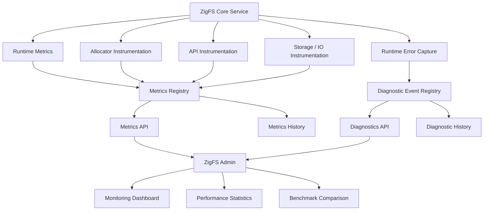

# ZigFS Runtime Monitoring 技术设计文档

> ZigFS 运行时监控、性能分析、内存安全诊断与性能对比系统

- 项目名称：ZigFS
- 模块名称：Runtime Monitoring
- 文档版本：v1.0
- 文档状态：技术设计
- 目标：建立完整的 ZigFS 运行时监控与性能分析体系

---

# 1. 项目目标

为 ZigFS 构建一套完整的运行时监控、性能分析、异常检测和性能对比系统。

系统应能够在 ZigFS 正常运行期间，实时采集服务资源使用情况，并通过 Admin 管理后台直观展示运行状态。

核心目标：

1. 实时监控 CPU、内存、线程、磁盘、网络等系统资源。
2. 监控 ZigFS S3 API 请求性能。
3. 检测内存分配失败、内存泄漏风险、资源泄漏等运行时问题。
4. 支持内存安全检测、崩溃诊断和线程异常分析。
5. 提供历史指标统计和趋势分析。
6. 支持 ZigFS 与 MinIO、RustFS 的性能对比。
7. 提供 Prometheus 指标导出能力。
8. 尽量降低正式运行环境中的监控开销。

# 2. 系统架构

## 2.1 总体架构



## 2.2 核心子系统

| 子系统 | 名称 | 职责 |
|---|---|---|
| 指标采集 | zigfs-metrics | 实时采集系统及服务指标 |
| 内存监控 | zigfs-memory-monitor | 监控 Allocator 与内存使用 |
| 请求监控 | zigfs-api-monitor | 统计 S3 API 请求性能 |
| 运行时诊断 | zigfs-diagnostics | 检测运行时异常与资源泄漏 |
| 历史统计 | zigfs-metrics-history | 指标采样、存储与趋势分析 |
| 性能测试 | zigfs-benchmark | ZigFS、MinIO、RustFS 性能对比 |
| 可视化 | zigfs-admin-monitoring | Admin 监控中心 |

# 3. 指标分类

指标分为以下八大类：

1. CPU 性能指标
2. 内存与 Allocator 指标
3. 线程与并发指标
4. API 请求性能指标
5. 磁盘与文件系统指标
6. 网络与连接指标
7. 运行时安全与异常指标
8. 后台任务与资源队列指标

指标检测模式：

| 模式 | 说明 |
|---|---|
| 实时检测 | 当前运行状态，周期性采样 |
| 统计检测 | 时间窗口内的累计、平均、峰值等统计 |
| 趋势检测 | 通过历史数据分析资源变化 |
| 事件检测 | 发生异常时记录诊断事件 |
| 调试检测 | 使用 Debug Allocator、Sanitizer 等工具 |

# 4. CPU 性能监控

## 4.1 实时指标

| 指标 | 说明 | 优先级 |
|---|---|---|
| process_cpu_usage | ZigFS 进程 CPU 使用率 | P0 |
| system_cpu_usage | 系统 CPU 使用率 | P0 |
| cpu_core_count | CPU 核心数量 | P0 |
| process_user_cpu_time | 用户态 CPU 时间 | P1 |
| process_kernel_cpu_time | 内核态 CPU 时间 | P1 |
| cpu_per_core_usage | 单核 CPU 使用率 | P1 |
| context_switches | 上下文切换次数 | P2 |
| load_average | 系统平均负载 | P1 |

## 4.2 统计指标

- CPU 平均使用率
- CPU 最大使用率
- CPU P95 使用率
- CPU 使用率趋势
- 用户态 CPU 时间累计
- 内核态 CPU 时间累计
- 上下文切换频率

## 4.3 监控目的

- 判断 CPU 是否成为服务瓶颈。
- 判断是否存在单核性能瓶颈。
- 识别 CPU 使用率异常升高。
- 为 ZigFS 与 MinIO、RustFS 性能对比提供数据。

# 5. 内存监控

## 5.1 操作系统内存指标

| 指标 | 说明 | 优先级 |
|---|---|---|
| process_rss_bytes | 进程实际驻留物理内存 | P0 |
| process_virtual_memory_bytes | 进程虚拟内存 | P0 |
| process_peak_rss_bytes | 进程历史内存峰值 | P0 |
| system_memory_total_bytes | 系统总内存 | P0 |
| system_memory_available_bytes | 系统可用内存 | P0 |
| system_memory_used_percent | 系统内存使用率 | P0 |

## 5.2 Allocator 指标

| 指标 | 说明 | 优先级 |
|---|---|---|
| allocator_allocated_bytes | 当前活跃分配字节数 | P0 |
| allocator_peak_allocated_bytes | 活跃分配内存峰值 | P0 |
| allocator_allocation_count | 当前活跃分配数量 | P0 |
| allocator_total_allocations | 累计分配次数 | P0 |
| allocator_total_frees | 累计释放次数 | P0 |
| allocator_total_allocated_bytes | 累计分配字节数 | P1 |
| allocator_total_freed_bytes | 累计释放字节数 | P1 |
| allocator_allocation_failures | 分配失败次数 | P0 |
| allocator_reallocation_count | 重分配次数 | P1 |

## 5.3 内存监控要求

需要区分以下内存指标：

- RSS：操作系统视角的实际驻留内存。
- Virtual Memory：虚拟地址空间使用情况。
- Allocated Heap：Allocator 视角的活跃分配内存。
- Peak Memory：历史内存峰值。
- Allocation Count：活跃内存分配数量。

这些指标不能相互替代。

## 5.4 内存趋势检测

定期采集：

- RSS
- Heap Allocated
- 活跃分配数量
- 分配失败次数
- 内存峰值

分析：

- 内存是否持续增长。
- 请求结束后内存是否回落。
- 多轮负载测试后内存基线是否持续增加。
- 活跃分配数量是否异常增长。

注意：内存增长不一定是内存泄漏。缓存、内存池、Allocator 保留内存都可能导致 RSS 不下降。

# 6. 线程与并发监控

## 6.1 实时指标

| 指标 | 说明 | 优先级 |
|---|---|---|
| process_thread_count | 当前 OS 线程数量 | P0 |
| process_peak_thread_count | 线程数量峰值 | P1 |
| active_worker_count | 活跃 Worker 数量 | P0 |
| idle_worker_count | 空闲 Worker 数量 | P1 |
| active_request_count | 当前活跃请求数量 | P0 |
| max_concurrent_requests | 历史最大请求并发 | P1 |
| blocked_task_count | 阻塞任务数量 | P1 |
| thread_creation_total | 累计创建线程数量 | P1 |
| thread_context_switches | 线程上下文切换 | P2 |

## 6.2 诊断指标

- 线程数量异常增长
- 线程阻塞时间
- 锁等待时间
- 锁竞争次数
- 线程死锁风险
- Worker 队列积压
- 线程堆栈采集

ZigFS 使用 Zig，不应采用 Go Goroutine 监控模型。

# 7. API 请求性能监控

## 7.1 实时指标

| 指标 | 说明 | 优先级 |
|---|---|---|
| api_requests_per_second | 每秒请求数 | P0 |
| api_active_requests | 当前活跃请求数 | P0 |
| api_request_latency_avg | 平均请求延迟 | P0 |
| api_request_latency_p50 | P50 延迟 | P0 |
| api_request_latency_p95 | P95 延迟 | P0 |
| api_request_latency_p99 | P99 延迟 | P0 |
| api_request_error_rate | 请求错误率 | P0 |
| api_http_4xx_total | HTTP 4xx 数量 | P1 |
| api_http_5xx_total | HTTP 5xx 数量 | P0 |
| api_request_timeout_total | 请求超时次数 | P0 |
| api_upload_bytes_per_second | 上传吞吐量 | P0 |
| api_download_bytes_per_second | 下载吞吐量 | P0 |

## 7.2 S3 API 分类统计

| API | 请求总数 | 延迟统计 | 错误率 | 吞吐量 |
|---|---|---|---|---|
| PUT Object | 支持 | 支持 | 支持 | 支持 |
| GET Object | 支持 | 支持 | 支持 | 支持 |
| HEAD Object | 支持 | 支持 | 支持 | 不适用 |
| DELETE Object | 支持 | 支持 | 支持 | 不适用 |
| LIST Objects | 支持 | 支持 | 支持 | 不适用 |
| Create Bucket | 支持 | 支持 | 支持 | 不适用 |
| Multipart Upload | 支持 | 支持 | 支持 | 支持 |
| Complete Multipart | 支持 | 支持 | 支持 | 支持 |

## 7.3 请求统计维度

- API 操作类型
- HTTP 状态码
- 请求耗时
- 请求数据大小
- 响应数据大小
- 请求成功率
- 请求错误率
- 请求吞吐量

不得将 Access Key、Secret Key、完整对象路径等敏感数据作为 Metrics Label。

# 8. 磁盘与文件系统监控

## 8.1 实时指标

| 指标 | 说明 | 优先级 |
|---|---|---|
| storage_total_bytes | 存储总容量 | P0 |
| storage_used_bytes | 已使用容量 | P0 |
| storage_available_bytes | 可用容量 | P0 |
| storage_usage_percent | 存储使用率 | P0 |
| disk_read_bytes_per_second | 磁盘读取速度 | P0 |
| disk_write_bytes_per_second | 磁盘写入速度 | P0 |
| disk_read_iops | 读取 IOPS | P1 |
| disk_write_iops | 写入 IOPS | P1 |
| disk_io_latency | 磁盘 IO 延迟 | P1 |
| open_file_descriptors | 当前打开文件句柄数 | P0 |
| file_descriptor_limit | 文件句柄上限 | P0 |
| storage_io_errors_total | 存储 IO 错误次数 | P0 |
| storage_path_status | 存储路径状态 | P0 |

## 8.2 监控内容

- 存储路径是否正常。
- 存储空间是否不足。
- 文件句柄是否接近上限。
- 磁盘 IO 是否成为瓶颈。
- 文件读写错误是否增加。
- 是否出现文件句柄泄漏。

# 9. 网络与连接监控

| 指标 | 说明 | 优先级 |
|---|---|---|
| network_receive_bytes_per_second | 网络接收速度 | P0 |
| network_transmit_bytes_per_second | 网络发送速度 | P0 |
| network_receive_bytes_total | 累计接收字节数 | P1 |
| network_transmit_bytes_total | 累计发送字节数 | P1 |
| tcp_connection_count | TCP 连接数 | P0 |
| http_active_connections | 活跃 HTTP 连接 | P0 |
| keep_alive_connections | Keep-Alive 连接数 | P1 |
| connection_rejected_total | 连接拒绝次数 | P1 |
| network_errors_total | 网络错误次数 | P0 |
| connection_timeout_total | 连接超时次数 | P0 |

# 10. 运行时异常检测

## 10.1 内存安全问题

| 异常 | 说明 | 检测方式 |
|---|---|---|
| Memory Leak | 内存泄漏 | Allocator 跟踪、快照 |
| Allocation Failure | 内存分配失败 | Allocator 错误捕获 |
| OOM | 内存不足 | 系统事件、分配错误 |
| Null Pointer Dereference | 空指针解引用 | 代码检查、运行时崩溃捕获 |
| Use-after-free | 释放后使用 | ASan 等工具 |
| Double-free | 重复释放 | Debug Allocator、ASan |
| Buffer Overflow | 缓冲区越界写入 | ASan |
| Buffer Underflow | 缓冲区越界读取 | ASan |
| Uninitialized Memory | 未初始化内存访问 | MemorySanitizer 等工具 |
| Memory Fragmentation | 内存碎片 | Allocator 统计、分析 |
| Invalid Free | 非法释放 | Debug Allocator |

## 10.2 线程与资源问题

| 异常 | 说明 | 检测方式 |
|---|---|---|
| Deadlock | 死锁 | 锁诊断、线程堆栈 |
| Race Condition | 数据竞争 | TSan |
| Lock Contention | 锁竞争 | 锁等待时间统计 |
| Stack Overflow | 线程栈溢出 | 崩溃信号、栈检查 |
| Thread Leak | 线程泄漏 | 线程数量趋势 |
| Resource Leak | 资源泄漏 | 资源计数 |
| Connection Leak | 连接泄漏 | 连接生命周期统计 |
| FD Exhaustion | 文件句柄耗尽 | FD 数量与上限 |
| Queue Overflow | 队列溢出 | 队列容量与丢弃计数 |
| Panic / Crash | 服务崩溃 | 崩溃记录、系统日志 |
| Infinite Loop | 无限循环 | CPU Profiling、线程堆栈 |

## 10.3 Debug 检测模式

建议支持两种运行模式。

### Production Mode

低开销持续监控：

- CPU
- RSS
- Heap
- 线程数
- 请求性能
- IO 性能
- 内存分配失败
- OOM 事件
- 资源泄漏风险
- 异常退出记录

### Diagnostic Mode

调试与专项检测：

- AddressSanitizer
- UndefinedBehaviorSanitizer
- ThreadSanitizer
- Zig Debug Allocator
- 内存分配追踪
- 泄漏检测
- 崩溃堆栈
- 内存热点分析

Sanitizer 通常用于调试构建或专项测试构建，不应默认在生产环境全部开启。

# 11. 历史统计与趋势分析

## 11.1 统计时间窗口

支持：

- 最近 1 分钟
- 最近 5 分钟
- 最近 15 分钟
- 最近 1 小时
- 最近 24 小时
- 自服务启动以来

## 11.2 统计内容

| 指标 | 统计方式 |
|---|---|
| CPU | 平均值、最大值、P95 |
| 内存 | 平均值、峰值、增长率 |
| 线程 | 平均值、峰值 |
| QPS | 平均值、峰值 |
| API 延迟 | P50、P95、P99、最大值 |
| 上传吞吐量 | 平均值、峰值 |
| 下载吞吐量 | 平均值、峰值 |
| 错误率 | 总数、比例、趋势 |
| 内存分配 | 累计分配次数、字节数 |
| 内存释放 | 累计释放次数、字节数 |
| 磁盘 IO | 平均值、峰值 |
| 网络 IO | 平均值、峰值 |

## 11.3 内存泄漏趋势分析

检测流程：

1. 服务启动后记录内存基线。
2. 定期记录 RSS、Heap Allocated、活跃分配数量。
3. 进行固定负载测试。
4. 负载结束后观察内存是否回落。
5. 多轮测试比较内存基线。
6. 对持续增长的内存发出告警。
7. 必要时生成内存快照。

内存泄漏判定应采用趋势与诊断证据结合的方式，不能仅依赖 RSS。

# 12. Benchmark 性能对比

## 12.1 对比对象

- ZigFS
- MinIO
- RustFS

## 12.2 对比指标

| 指标 | 说明 |
|---|---|
| CPU 使用率 | 同等负载下的 CPU 消耗 |
| RSS 内存 | 同等负载下的进程内存 |
| Heap 内存 | 可获取时比较 |
| 线程数量 | 线程资源消耗 |
| PUT QPS | 上传请求处理能力 |
| GET QPS | 下载请求处理能力 |
| PUT Throughput | 上传吞吐量 |
| GET Throughput | 下载吞吐量 |
| P95 Latency | 请求 P95 延迟 |
| P99 Latency | 请求 P99 延迟 |
| Disk IOPS | 磁盘操作能力 |
| Memory Growth | 长时间运行内存增长 |
| CPU per Request | 单位请求 CPU 成本 |
| Error Rate | 请求错误率 |

## 12.3 Benchmark 测试场景

| 场景 | 目的 |
|---|---|
| 1 KB 小文件 | 元数据与请求开销 |
| 1 MB 文件 | 普通文件传输 |
| 100 MB 文件 | 大文件吞吐量 |
| 1 GB 文件 | 大文件传输效率 |
| 高并发小请求 | 请求处理能力 |
| 并发上传 | 上传并发性能 |
| 并发下载 | 下载并发性能 |
| 30 分钟持续负载 | 内存稳定性 |
| 2 小时持续负载 | 长时间资源泄漏风险 |

## 12.4 测试条件

必须统一：

- 测试机器
- CPU 核数
- 内存限制
- 磁盘与文件系统
- 网络环境
- 对象大小
- 并发数量
- 数据集
- S3 API
- 认证方式
- 测试客户端
- 测试时长

## 12.5 Benchmark 报告

每次测试生成独立报告：

- 测试时间
- 软件版本
- 系统配置
- 测试参数
- CPU 使用率
- 内存峰值
- QPS
- 上传下载吞吐量
- P95/P99 延迟
- 错误率
- 测试结论

Benchmark 运行应独立于正常监控采集逻辑，避免压测组件影响服务性能。

# 13. Admin 监控中心 UI

## 13.1 菜单结构

```text
Monitoring Center
├── System Overview
├── CPU Monitoring
├── Memory Monitoring
├── Thread & Concurrency
├── API Performance
├── Storage & Disk
├── Network Monitoring
├── Runtime Diagnostics
├── Performance Statistics
├── Benchmark Comparison
└── Alert Management
```

## 13.2 系统概览

首页展示：

### 状态卡片

- CPU 使用率
- 内存占用
- 线程数量
- API QPS
- 活跃请求数
- 上传速度
- 下载速度
- 错误率

### 趋势图

- CPU 使用率趋势
- 内存使用趋势
- 线程数量趋势
- API QPS 趋势
- P95/P99 延迟趋势
- 上传下载速度趋势

### 异常事件列表

- 内存分配失败
- 内存增长告警
- 文件句柄异常
- 存储 IO 错误
- API 错误
- 服务崩溃
- 运行时诊断事件

## 13.3 内存监控页面

建议包含：

- RSS 使用量
- Heap Allocated
- Peak Memory
- Allocation Count
- Free Count
- Allocation Failure Count
- 内存增长曲线
- 内存基线对比
- 内存快照入口

## 13.4 API 性能页面

建议包含：

- QPS
- 活跃请求数
- P50/P95/P99 延迟
- API 错误率
- S3 API 分类统计
- 上传下载吞吐量
- API 请求趋势

## 13.5 Runtime Diagnostics 页面

建议包含：

- 异常事件列表
- 事件等级
- 事件类型
- 发生时间
- 发生次数
- 诊断模式状态
- 崩溃记录
- 内存快照
- 线程堆栈
- 诊断报告

# 14. Metrics API 设计

建议使用以下接口。

| API | 方法 | 用途 |
|---|---|---|
| /admin/monitoring/overview | GET | 实时系统概览 |
| /admin/monitoring/cpu | GET | CPU 指标 |
| /admin/monitoring/memory | GET | 内存指标 |
| /admin/monitoring/threads | GET | 线程与并发指标 |
| /admin/monitoring/storage | GET | 存储指标 |
| /admin/monitoring/network | GET | 网络指标 |
| /admin/monitoring/api | GET | API 性能指标 |
| /admin/monitoring/history | GET | 历史统计 |
| /admin/diagnostics/events | GET | 运行时异常事件 |
| /admin/diagnostics/snapshots | GET | 诊断快照列表 |
| /admin/diagnostics/report | GET | 诊断报告 |
| /metrics | GET | Prometheus Metrics Exporter |

实时数据传输建议：

- REST API：首次加载与查询。
- SSE 或 WebSocket：实时指标推送。
- 历史查询 API：趋势数据查询。

# 15. 指标采集与数据存储

## 15.1 采样策略

建议初始采样频率：

| 数据类型 | 采样间隔 |
|---|---|
| CPU | 1 秒 |
| RSS / Memory | 1 秒 |
| Heap | 1 秒 |
| 线程数 | 1 秒 |
| 活跃请求数 | 1 秒 |
| QPS | 1 秒 |
| 网络 IO | 1 秒 |
| 磁盘 IO | 1 秒或 5 秒 |
| 历史统计 | 10 秒或 60 秒聚合 |
| 诊断事件 | 事件触发 |

以上采样频率可配置，应支持降低频率以减少监控开销。

## 15.2 数据存储策略

建议：

- 实时指标：内存 Metrics Registry。
- 历史指标：轻量级本地存储。
- 诊断事件：本地事件记录。
- Benchmark 报告：独立报告存储。
- Prometheus：通过 Exporter 提供外部采集。

不要每秒将全部指标直接写入 PostgreSQL。

建议使用采样、聚合和批量持久化策略。

# 16. 告警系统

## 16.1 告警等级

| 等级 | 说明 |
|---|---|
| Info | 普通运行事件 |
| Warning | 资源异常趋势 |
| Error | 运行时错误 |
| Critical | 服务稳定性受到严重影响 |

## 16.2 建议初始告警规则

| 告警 | 默认触发条件 |
|---|---|
| CPU High | CPU > 90% 持续 60 秒 |
| Memory High | RSS > 配置阈值 |
| Memory Growth | 内存持续增长且超过阈值 |
| Allocation Failure | 出现内存分配失败 |
| Thread High | 线程数量超过配置阈值 |
| FD High | 文件句柄使用率 > 80% |
| Storage Low | 存储剩余空间低于阈值 |
| API Error High | 5xx 错误率超过阈值 |
| API Latency High | P99 超过阈值 |
| IO Error | 出现存储 IO 错误 |

所有阈值均应可配置。

# 17. 实现优先级

## P0：第一阶段

实现基础运行时监控。

- CPU 使用率
- RSS
- Heap
- Peak Memory
- Allocation / Free 统计
- Allocation Failure
- OS 线程数量
- Worker 数量
- 活跃请求数
- QPS
- P50/P95/P99
- API 错误率
- 上传下载吞吐量
- 磁盘容量
- 磁盘 IO
- 文件句柄
- 网络 IO
- Metrics Registry
- Prometheus Exporter
- Admin 系统概览
- 历史统计

## P1：第二阶段

实现性能分析与稳定性诊断。

- 内存泄漏趋势检测
- 线程堆栈
- CPU Profiling
- 内存分配热点
- 锁竞争分析
- 资源泄漏检测
- 告警管理
- S3 API 分类统计
- Benchmark 自动化
- ZigFS / MinIO / RustFS 对比

## P2：第三阶段

实现专业诊断能力。

- ASan
- UBSan
- TSan
- Debug Allocator
- Use-after-free 检测
- Double-free 检测
- Buffer Overflow 检测
- 内存快照
- 崩溃 Dump
- 符号化堆栈
- 长时间压力测试
- 自动生成诊断报告

# 18. 设计原则

1. 正式运行模式下监控开销必须尽可能低。
2. 监控系统不能阻塞核心 S3 请求处理。
3. 指标采集应采用线程安全设计。
4. 指标采集失败不得导致 ZigFS 主服务崩溃。
5. 历史数据应采用低频采样与聚合。
6. Metrics Label 必须控制基数。
7. 敏感认证信息不得出现在监控指标中。
8. Debug 诊断功能应与 Production 监控分离。
9. 性能对比必须统一测试环境。
10. 所有资源阈值均应可配置。
11. 监控模块应支持平台差异化实现。
12. 不应将 RSS 下降作为唯一内存泄漏判定标准。

# 19. 最终目标

ZigFS Runtime Monitoring 最终应实现：

- 服务运行状态实时可视化。
- CPU、内存、线程、磁盘、网络全面监控。
- S3 API 请求性能统计。
- 内存泄漏风险检测。
- 运行时异常事件记录。
- 资源泄漏诊断。
- 历史性能趋势分析。
- Prometheus 兼容指标输出。
- ZigFS、MinIO、RustFS 性能对比。
- 可生成完整的 Benchmark 报告。
- 支持 Debug 与 Production 两种监控模式。

最终形成一套适用于 ZigFS 单机对象存储服务的完整运行时监控与性能诊断系统。
