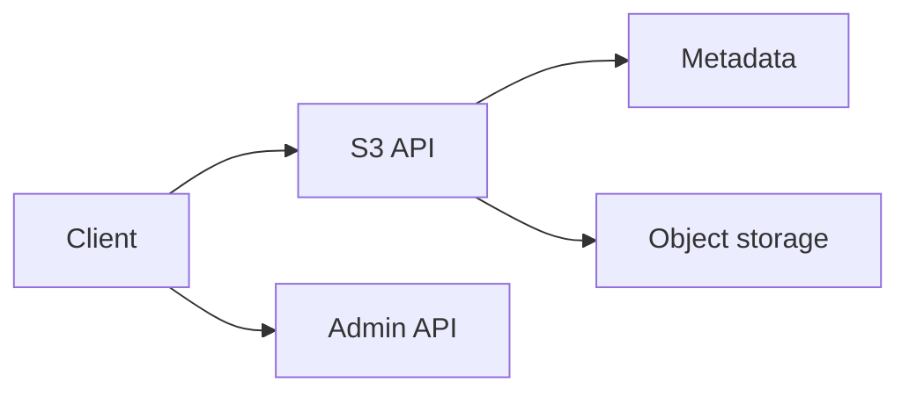

# ZigFS

ZigFS is a fast, self-hosted object storage service with an S3-compatible API, a management console, and the `zc` command-line client.

## Explore the documentation

- [Getting Started](./getting-started)
- [Concepts](./concepts)
- [S3 API Reference](./s3-api)
- [CLI Reference](./cli)
- [Administration](./administration)
- [Security](./security)
- [Deployment](./deployment)
- [Troubleshooting](./troubleshooting)
- [Reference](./reference)

## Architecture

