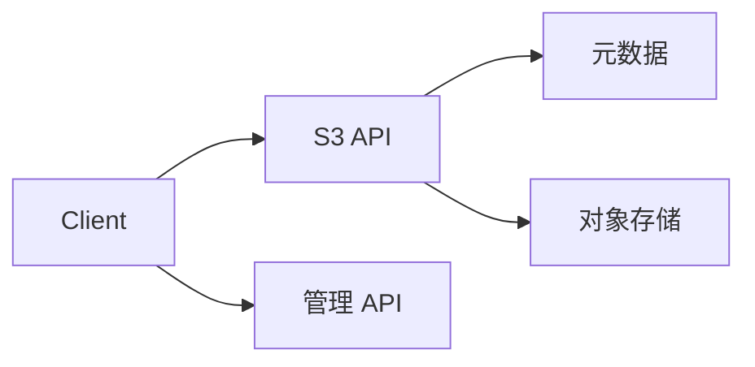

# ZigFS

ZigFS 是一个快速、可自托管的对象存储服务，提供 S3 兼容 API、管理中心和 `zc` 命令行客户端。

## 文档导航

- [快速开始](./getting-started)
- [核心概念](./concepts)
- [S3 API 参考](./s3-api)
- [CLI 参考](./cli)
- [管理中心](./administration)
- [安全](./security)
- [部署](./deployment)
- [故障排查](./troubleshooting)
- [参考](./reference)

## 架构概览

